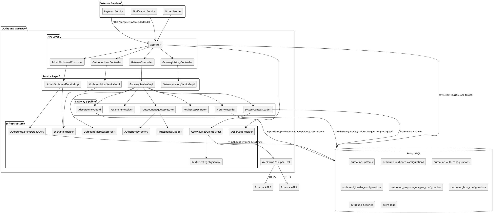
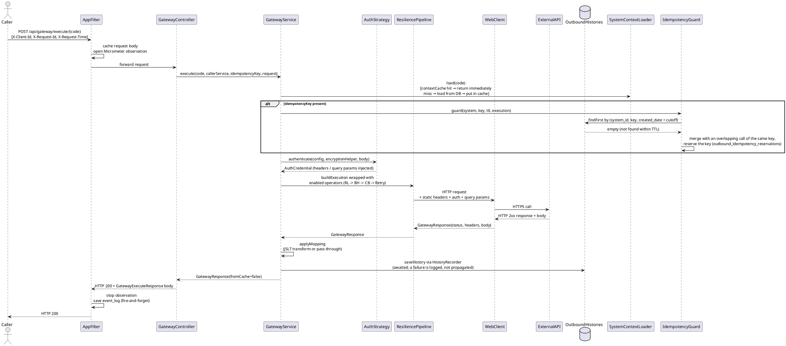
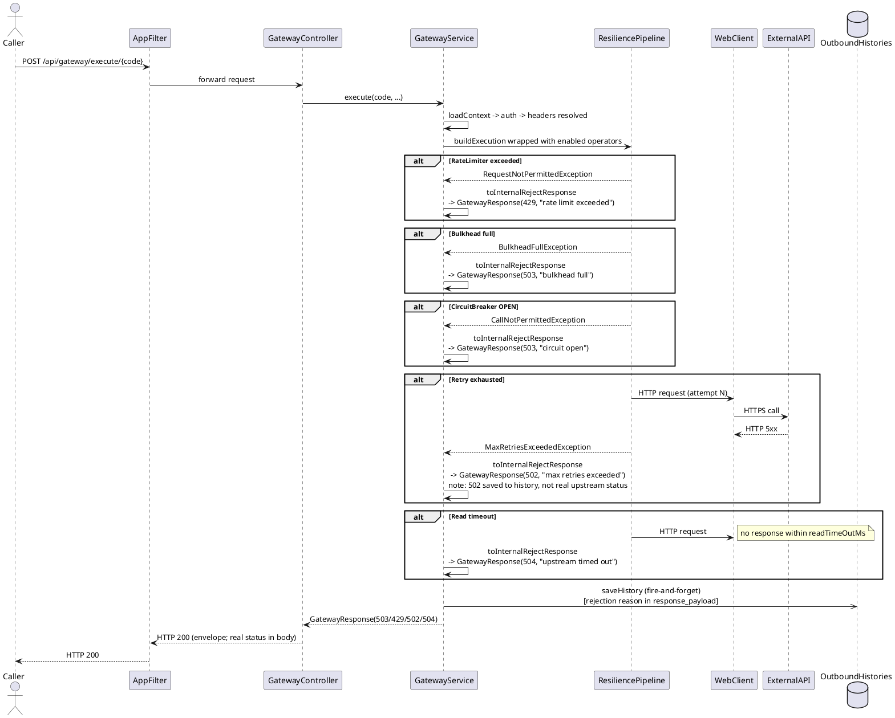
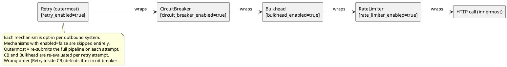
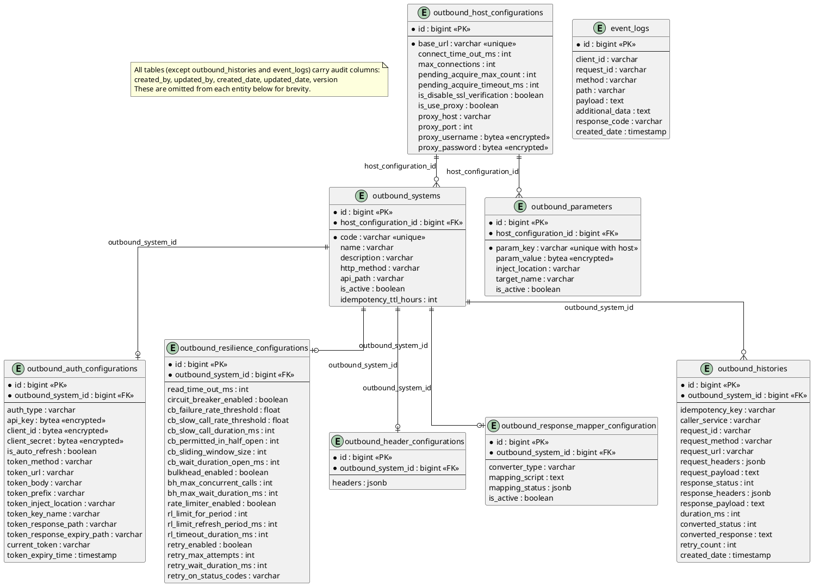

# Outbound Gateway

A centralized reactive microservice that acts as the single egress point from internal services to external APIs.
All configuration is stored in the database — no restart is needed to add, update, or toggle outbound systems.

---

## Table of Contents

1. [Overview](#1-overview)
2. [Architecture](#2-architecture)
3. [Tech Stack](#3-tech-stack)
4. [ERD](#4-erd)
5. [Feature & Capability](#5-feature--capability)
6. [Auth Strategy](#6-auth-strategy)
7. [Resilience Configuration](#7-resilience-configuration)
8. [Response Mapper](#8-response-mapper)
9. [API Specification](#9-api-specification)
10. [Metrics](#10-metrics)
11. [Error Response](#11-error-response)
12. [Important Notes](#12-important-notes)
13. [Configure & Use](#13-configure--use)
    - [Prerequisites](#prerequisites)
    - [Running Tests](#running-tests)
    - [Step-by-Step Walkthrough](#step-by-step-walkthrough)

---

## 1. Overview

Outbound Gateway centralizes all outbound HTTP calls from your internal services into one managed egress point. Instead of each service managing its own HTTP clients, auth tokens, resilience policies, and audit logs, all of that is configured once in the gateway and shared.

| Concern | Without Gateway | With Gateway |
|---|---|---|
| Auth tokens | Each service manages OAuth refresh, HMAC signing, RSA | Gateway handles it — tokens cached and auto-refreshed |
| Resilience | Each service configures its own CB/Retry (or skips it) | Per-system CB, Bulkhead, Rate Limiter, Retry — all in DB |
| Audit trail | Each service logs differently, hard to correlate | Every call saved to `outbound_histories` with full request/response |
| Connection pools | Each service creates its own Netty pools | One pool per host, shared across all systems on that host |
| Config changes | Redeploy required | Admin API hot-reload, zero downtime |
| Encryption | Each service handles credential storage | AES-256-GCM for all sensitive fields, gateway encrypts on write |

**Intended use:** internal service mesh where multiple services call the same external APIs (payment gateways, notification providers, third-party data services).

---

## 2. Architecture

### Component Diagram



### Execution Flow — Happy Path



### Execution Flow — Error Path (Resilience Rejection)



### Resilience Pipeline Order



Only mechanisms with `enabled = true` are applied. A system with no enabled mechanisms runs with the configured read timeout only.

### Context Cache Design

`SystemContextLoader` maintains a two-layer cache to avoid repeated DB round-trips on the hot path (`GatewayServiceImpl` only calls it):

| Layer | Purpose |
|---|---|
| `contextCache` (hot path) | Returns the cached `OutboundSystemContext` immediately for warm keys |
| `contextLoadCache` (dedup) | Uses `Mono.cache()` — concurrent requests during a cold-start share one DB round-trip |

`doFinally` evicts the load cache after completion (success or error), preventing stale `Mono` objects from persisting.

### Connection Pool Design

One Reactor Netty connection pool per `baseUrl` (scheme + host + port), shared across all outbound systems pointing to the same host:

```
webClientCache (one pool per host)
  "https://api.xendit.co"
      ├── /v1/charges   → system "xendit-charge"   (CB + Bulkhead)
      └── /v1/refunds   → system "xendit-refund"   (CB only)
  "https://api.midtrans.com"
      └── /v2/charge    → system "midtrans-charge" (Rate Limiter + Retry)
```

---

## 3. Tech Stack

| Layer | Library / Version |
|---|---|
| **Runtime** | Java 21, Spring Boot 3.5.0 |
| **Web** | Spring WebFlux (Reactor Netty) |
| **Database (reactive)** | Spring Data R2DBC, r2dbc-postgresql |
| **Database (migrations)** | Flyway Core + flyway-database-postgresql |
| **Database (JDBC)** | PostgreSQL JDBC (Flyway only) |
| **Resilience** | Resilience4j 2.4.0 (spring-boot3, reactor, micrometer) |
| **HTTP logging** | Zalando Logbook 3.12.3 (spring-webflux, netty, json) |
| **Tracing** | Micrometer Tracing (Brave bridge), Zipkin Brave SLF4J |
| **Metrics** | Micrometer Prometheus registry |
| **JSON transform** | JSLT 0.1.14 |
| **JSONPath** | Jayway JsonPath (Spring Boot BOM managed) |
| **ID generation** | TSID Creator 5.2.6 |
| **Serialization** | Jackson (via Spring Boot), Gson 2.13.2 |
| **Caching** | Caffeine (via Spring Boot Cache) |
| **Logging** | Log4j2 async via LMAX Disruptor 3.4.4 |
| **Testing** | JUnit 5, Reactor Test, Testcontainers 1.21.0 (postgres:16-alpine), WireMock 3.13.1, Awaitility 4.3.0 |

---

## 4. ERD



> Render with [plantuml.com](https://www.plantuml.com/plantuml/uml/), the IntelliJ **PlantUML Integration** plugin, or the VS Code **PlantUML** extension. GitHub does not render PlantUML natively.

**Relationship notes:**

- Each `outbound_systems` row has **at most one** row in each sub-config table. A missing row means: no auth (pass-through), no resilience (bypass), no static headers, no response mapper.
- `outbound_host_configurations` is keyed by `base_url` — multiple outbound systems sharing the same host share one connection pool config.
- `outbound_parameters` holds host-level key/values that clients reference by key (`injectKeys`) to have a value injected into the outbound call. See [docs/OUTBOUND_PARAMETERS.md](docs/OUTBOUND_PARAMETERS.md).
- `outbound_histories` accumulates one row per gateway call (fire-and-forget, not transactional with the call itself).
- `bytea` columns (`api_key`, `client_id`, `client_secret`, `proxy_username`, `proxy_password`, `param_value`, `headers`, `mapping_status`) are AES-256-GCM encrypted or serialized via custom R2DBC converters.

---

## 5. Feature & Capability

| Feature | Detail |
|---|---|
| **Auth strategies** | None, API Key, Basic, Bearer Static, HMAC-SHA256, RSA, OAuth2 Client Credentials |
| **Resilience** | Circuit Breaker, Bulkhead, Rate Limiter, Retry — per system, independently opt-in |
| **Response mapping** | JSLT transform with status remap — pass-through when not configured |
| **Parameter injection** | Store key/values per host; client sends `injectKeys` and the gateway injects the values into header / query param / JSON body — see [docs/OUTBOUND_PARAMETERS.md](docs/OUTBOUND_PARAMETERS.md) |
| **Encryption** | AES-256-GCM for all sensitive fields (`api_key`, `client_id`, `client_secret`, proxy creds) |
| **Idempotency** | Per outbound system, TTL configurable, backed by DB history with upsert semantics |
| **Audit history** | Every call saved to `outbound_histories` including internal rejects |
| **Connection pool** | Per-host Reactor Netty pool with configurable size, acquire timeout, proxy, SSL |
| **Context cache** | Two-layer in-memory cache with thundering-herd deduplication via `Mono.cache()` |
| **Hot reload** | Evict cache + pool via Admin API — zero-restart config changes |
| **HTTP logging** | Logbook logs all outbound request/response pairs (JSON format) |
| **Distributed tracing** | `X-Client-Id` and `X-Request-Id` propagated as Brave baggage, correlated in logs |
| **Metrics** | Custom Micrometer observations + idempotency counter + Resilience4j auto-binding |
| **Observability** | Prometheus endpoint on separate actuator port |
| **Test connection** | Admin API endpoint to probe an outbound system's reachability |
| **Token persistence** | OAuth tokens cached in memory and persisted to DB — survives service restart |

---

## 6. Auth Strategy

All auth strategies implement the same `AuthStrategy` interface. The strategy is selected per outbound system based on `auth_type`. Sensitive fields are stored as AES-256-GCM encrypted `bytea` — send plaintext values to the Admin API.

### NONE

No authentication. Headers are sent as-is.

| Field | Required | Description |
|---|---|---|
| `authType` | Yes | `"NONE"` |

---

### API_KEY

Injects a static key into a header, query parameter, or cookie.

| Field | Required | Description |
|---|---|---|
| `authType` | Yes | `"API_KEY"` |
| `apiKey` | Yes | The raw key value — gateway encrypts on write |
| `tokenKeyName` | Yes | Name of the header/param/cookie (e.g. `"X-API-Key"`) |
| `tokenInjectLocation` | Yes | `HEADER`, `QUERY_PARAM`, or `COOKIE` |

---

### BASIC

Encodes `clientId:clientSecret` as Base64 and injects as `Authorization: Basic <encoded>`.

| Field | Required | Description |
|---|---|---|
| `authType` | Yes | `"BASIC"` |
| `clientId` | Yes | Username — gateway encrypts on write |
| `clientSecret` | Yes | Password — gateway encrypts on write |

The `Authorization` header name and `Basic` prefix are hardcoded.

---

### BEARER_STATIC

Injects a static bearer token. Unlike OAuth, this token never refreshes automatically.

| Field | Required | Description |
|---|---|---|
| `authType` | Yes | `"BEARER_STATIC"` |
| `clientSecret` | Yes | The raw static token value — gateway encrypts on write |
| `tokenPrefix` | No | Prefix prepended to the token (default `"Bearer"`) |
| `tokenKeyName` | Yes | Header name (usually `"Authorization"`) |

Result: `Authorization: Bearer <token>`

---

### HMAC

Signs the request body with HMAC-SHA256 using `clientSecret` as the signing key. The signature is injected as a header.

| Field | Required | Description |
|---|---|---|
| `authType` | Yes | `"HMAC"` |
| `clientSecret` | Yes | HMAC signing key — gateway encrypts on write |
| `tokenKeyName` | Yes | Header name to inject the signature (e.g. `"X-Signature"`) |

The signature is `Base64(HMAC-SHA256(clientSecret, requestBody))` — no key ID prefix. `clientId` is not used by this strategy and is not required for `HMAC`.

---

### RSA

Signs the request body with an RSA private key using SHA256withRSA. The signature is Base64-encoded and injected as a header.

| Field | Required | Description |
|---|---|---|
| `authType` | Yes | `"RSA"` |
| `clientId` | Yes | Required by validation, but not used for signing |
| `clientSecret` | Yes | Base64-encoded PKCS#8 DER-format RSA private key — gateway encrypts on write |
| `tokenKeyName` | Yes | Header name to inject the RSA signature |

`clientSecret` must be the private key's raw PKCS#8 DER bytes, Base64-encoded (e.g. `openssl pkcs8 -topk8 -nocrypt -in key.pem -outform DER | base64`) — not a PEM string. The gateway decodes the Base64 once on write, encrypts the raw DER bytes, and loads them directly via `PKCS8EncodedKeySpec` on first use.

---

### OAUTH

OAuth2 Client Credentials flow. Fetches a token from the token URL, caches it in memory, and persists it to DB for restart survival. Auto-refreshes when expired if `autoRefresh = true`.

| Field | Required | Description |
|---|---|---|
| `authType` | Yes | `"OAUTH"` |
| `clientId` | Yes | OAuth client ID — gateway encrypts on write |
| `clientSecret` | Yes | OAuth client secret — gateway encrypts on write |
| `tokenUrl` | Yes | Token endpoint URL |
| `tokenMethod` | Yes | HTTP method for the token request (usually `"POST"`) |
| `tokenBody` | No | Additional form body fields beyond `grant_type=client_credentials` |
| `tokenPrefix` | No | Prefix for the injected token value (e.g. `"Bearer"`) |
| `tokenInjectLocation` | Yes | `HEADER`, `QUERY_PARAM`, or `COOKIE` |
| `tokenKeyName` | Yes | Header/param name to inject the token (e.g. `"Authorization"`) |
| `tokenResponsePath` | Yes | Key or JSONPath (`$.access_token`) to extract the token from the token response |
| `tokenResponseExpiryPath` | No | Key or JSONPath (`$.expires_in`) to extract expiry seconds from the token response |
| `autoRefresh` | No | If `true`, the gateway auto-refreshes the token when expired (default `false`) |

**Thundering-herd protection:** concurrent requests that all find an expired token share one token fetch via `Mono.cache()`. Only one HTTP request is issued regardless of burst.

---

## 7. Resilience Configuration

Each outbound system can independently opt into any combination of four mechanisms. The mechanisms wrap the HTTP call in this fixed order (outermost → innermost): **Retry → Circuit Breaker → Bulkhead → Rate Limiter → HTTP call**.

Only mechanisms with `enabled = true` are applied. A system with no row in `outbound_resilience_configurations` runs with no operators and no timeout.

### Circuit Breaker

Trips to OPEN when the failure or slow-call rate exceeds thresholds. Rejects calls immediately while OPEN.

| Field | Required | Description |
|---|---|---|
| `circuitBreakerEnabled` | Yes | Must be `true` to activate |
| `cbFailureRateThreshold` | Yes | Failure rate % to trip to OPEN (e.g. `50.0`) |
| `cbSlowCallRateThreshold` | Yes | Slow call rate % to trip to OPEN |
| `cbSlowCallDurationMs` | Yes | Call duration (ms) that counts as "slow" |
| `cbPermittedInHalfOpen` | Yes | Probe calls allowed in HALF_OPEN before closing or re-opening |
| `cbSlidingWindowSize` | Yes | Number of calls in the sliding window for rate calculation |
| `cbWaitDurationOpenMs` | Yes | How long (ms) the CB stays OPEN before moving to HALF_OPEN |

### Bulkhead

Limits the number of concurrent calls to this system.

| Field | Required | Description |
|---|---|---|
| `bulkheadEnabled` | Yes | Must be `true` to activate |
| `bhMaxConcurrentCalls` | Yes | Maximum concurrent calls allowed through |
| `bhMaxWaitDurationMs` | Yes | Max time (ms) a caller waits for a slot (0 = reject immediately if full) |

### Rate Limiter

Limits the number of calls allowed per refresh period.

| Field | Required | Description |
|---|---|---|
| `rateLimiterEnabled` | Yes | Must be `true` to activate |
| `rlLimitForPeriod` | Yes | Number of calls allowed per period |
| `rlLimitRefreshPeriodMs` | Yes | Duration (ms) of one refresh period |
| `rlTimeoutDurationMs` | Yes | Max time (ms) a caller waits for a permit (0 = reject immediately) |

### Retry

Retries the full pipeline on configured HTTP status codes.

| Field | Required | Description |
|---|---|---|
| `retryEnabled` | Yes | Must be `true` to activate |
| `retryMaxAttempts` | Yes | Total attempts including the first (e.g. `3` = 1 try + 2 retries) |
| `retryWaitDurationMs` | Yes | Fixed wait between attempts (ms) |
| `retryOnStatusCodes` | Yes | HTTP status codes that trigger a retry (e.g. `"500,502,503"`) |

Retry uses `retryOnResult` — a `503` response from the upstream triggers a retry without requiring a thrown exception.

### Read Timeout

| Field | Required | Description |
|---|---|---|
| `readTimeOutMs` | Yes | Max time (ms) to wait for the upstream response before a 504 |

### Internal Reject Status Codes

| Exception | HTTP Status | Meaning |
|---|---|---|
| `BulkheadFullException` | 503 | Too many concurrent calls |
| `CallNotPermittedException` | 503 | Circuit breaker is OPEN |
| `RequestNotPermitted` | 429 | Rate limit exceeded |
| `MaxRetriesExceededException` | 502 | All retry attempts exhausted |
| `TimeoutException` | 504 | Upstream timed out |
| Other | 503 | Unexpected internal error |

### Mechanism Combinations

| Use case | CB | Bulkhead | Rate Limiter | Retry |
|---|---|---|---|---|
| Protect against upstream instability | ✅ | | | ✅ |
| Limit concurrent calls only | | ✅ | | |
| Throttle outbound traffic | | | ✅ | |
| Full protection | ✅ | ✅ | ✅ | ✅ |
| Timeout only | | | | |

---

## 8. Response Mapper

The response mapper transforms the upstream's raw response body and/or remaps its HTTP status code before returning to the caller. Configuration is optional — if absent or `isActive = false`, the raw response passes through unchanged.

### NONE (pass-through)

- `body` = raw upstream response body
- `convertedResponse` = same as `body`
- `convertedStatus` = same as `responseStatus`

### JSLT

[JSLT](https://github.com/schibstedspain/jslt) is a JSON transform language. The `mappingScript` is evaluated against the upstream response JSON. Expressions are compiled once and cached in Caffeine.

**Example:**

Upstream response:
```json
{ "id": "ch_001", "amount": 100000, "status": "CAPTURED", "currency": "IDR" }
```

`mappingScript`:
```jslt
{"transactionId": .id, "amount": .amount, "status": .status}
```

`convertedResponse`:
```json
{"transactionId": "ch_001", "amount": 100000, "status": "CAPTURED"}
```

**Status remap:** `mappingStatus` maps upstream HTTP status codes (string keys) to replacement codes:

```json
{ "404": 400, "422": 400 }
```

With this config, an upstream `404` becomes `convertedStatus = 400`. The original `responseStatus` is still saved to history.

### Mapper Fields

| Field | Required | Description |
|---|---|---|
| `converterType` | Yes | `"NONE"` or `"JSLT"` |
| `mappingScript` | If JSLT | The JSLT transform expression |
| `mappingStatus` | No | JSON object: `{ "<upstream_status>": <converted_status> }` |
| `isActive` | Yes | `false` disables the mapper entirely (pass-through) |

---

## 9. API Specification

> **Base path**: All paths below are relative to the configured base path. With defaults, prepend `http://localhost:8080/app`.

**Required request headers on all endpoints:**

| Header | Description |
|---|---|
| `X-Client-Id` | Caller's client ID — used for request tracing |
| `X-Request-Id` | Unique request ID — correlated across all log lines |
| `X-Request-Time` | Request timestamp in ISO-8601 (e.g. `2026-05-20T08:00:00+07:00`) |

---

### Gateway API

#### `POST /api/gateway/execute/{code}`

Execute an outbound HTTP call through the configured outbound system.

**Additional headers:**

| Header | Required | Description |
|---|---|---|
| `X-Caller-Service` | No | Calling service name — saved to history |
| `X-Idempotency-Key` | No | Checks history first; returns cached result if within TTL. Ignored when `idempotencyTtlHours = 0` (idempotency disabled for that system). |
| `X-Request-Id` | No | Correlation ID handled by `AppFilter` — propagated to `outbound_histories.request_id` automatically |

**Request body:**
```json
{
  "queryParams": { "currency": "IDR" },
  "body": { "amount": 100000, "externalId": "order-123" },
  "injectKeys": ["partner-id"]
}
```

All fields are optional.

`injectKeys` references [outbound parameters](docs/OUTBOUND_PARAMETERS.md) configured on the system's host. For each key the gateway injects the stored value into the header, query param, or JSON body path configured for that key. Unknown, inactive, or other-host keys, (max 50 distinct keys per call), and invalid injections, are rejected with HTTP 400 and **no outbound call is made** (`violations.injectKeys`: `NotFound` / `NotValid`).

**Response (HTTP 200 — always):**
```json
{
  "response": { "code": "000", "description": "success", "time": "2026-05-19T08:00:00+07:00" },
  "data": {
    "status": 200,
    "headers": { "Content-Type": ["application/json"] },
    "body": { "id": "charge-abc", "status": "PENDING" },
    "convertedStatus": 200,
    "convertedResponse": { "id": "charge-abc", "status": "PENDING" },
    "fromCache": false,
    "mappingFallback": false
  }
}
```

| Field | Description |
|---|---|
| `fromCache` | `true` when the result was served from idempotency history without calling the upstream |
| `mappingFallback` | `true` when a JSLT mapper was configured but failed to execute — `convertedResponse` equals `body` and `convertedStatus` equals `status` (full pass-through; no body transform or status remap applied) |

**When blocked by a resilience mechanism:**
```json
{
  "response": { "code": "000", "description": "success" },
  "data": {
    "status": 503,
    "body": "service unavailable - circuit open",
    "convertedStatus": 503,
    "convertedResponse": "service unavailable - circuit open",
    "fromCache": false
  }
}
```

---

#### `GET /api/gateway/histories`

Paginated outbound call history with optional filters.

**Query parameters:**

| Param | Type | Default | Index covered | Description |
|---|---|---|---|---|
| `code` | String | — | ✅ `idx_histories_system_date` / `idx_histories_response_status` | Filter by outbound system code. Omit for full scan |
| `startDate` | ISO-8601 date (`yyyy-MM-dd`) | — | ✅ when `code` also set (`idx_histories_system_date`) | Lower bound on `created_date` |
| `endDate` | ISO-8601 date (`yyyy-MM-dd`) | — | ✅ when `code` also set (`idx_histories_system_date`) | Upper bound on `created_date` |
| `status` | Integer | — | ✅ when `code` also set (`idx_histories_response_status`) | Filter by `response_status` |
| `page` | Integer | `0` | — | Zero-based page number |
| `size` | Integer | `20` | — | Page size |

> Omitting `code` (query all systems) always results in a full table scan regardless of other filters — no index leads on `created_date` or `response_status` alone.

**Response:**
```json
{
  "response": { "code": "000", "description": "success" },
  "data": [
    {
      "id": 1,
      "outboundSystemId": 3,
      "idempotencyKey": "order-123",
      "callerService": "payment-service",
      "requestId": "req-abc-123",
      "requestMethod": "POST",
      "requestUrl": "https://api.xendit.co/v2/charges",
      "requestHeaders": { "Authorization": ["Bearer token"] },
      "requestPayload": { "amount": 100000 },
      "responseStatus": 200,
      "responseHeaders": { "Content-Type": ["application/json"] },
      "responsePayload": { "id": "charge-abc" },
      "durationMs": 342,
      "convertedStatus": 200,
      "convertedResponse": { "id": "charge-abc" },
      "retryCount": 0,
      "createdDate": "2026-05-19T07:55:00"
    }
  ],
  "pagination": {
    "page": 0,
    "size": 20,
    "totalElements": 1,
    "totalPages": 1
  }
}
```

> `data` is a bare array of history records; pagination metadata is a sibling top-level field, not nested inside `data`.

---

#### `GET /api/gateway/history/{code}?idempotencyKey={idempotencyKey}`

Look up a single history record by idempotency key. `code` is a **path variable** and `idempotencyKey` is a **required query parameter** (`@NotBlank`) — idempotency keys are scoped per outbound system. An unknown `code`, a blank/missing `code`, or an `idempotencyKey` with no matching record all return HTTP 400.

> Index: `idx_histories_idempotency (outbound_system_id, idempotency_key, created_date)` — fully covered. The same index covers the TTL check during `execute`.

**Response (found):**
```json
{
  "response": { "code": "000", "description": "success" },
  "data": {
    "id": 1,
    "outboundSystemId": 3,
    "idempotencyKey": "order-123",
    "callerService": "payment-service",
    "requestId": "req-abc-123",
    "requestMethod": "POST",
    "requestUrl": "https://api.xendit.co/v2/charges",
    "requestHeaders": { "Authorization": ["Bearer token"] },
    "requestPayload": { "amount": 100000 },
    "responseStatus": 200,
    "responseHeaders": { "Content-Type": ["application/json"] },
    "responsePayload": { "id": "charge-abc" },
    "durationMs": 342,
    "convertedStatus": 200,
    "convertedResponse": { "id": "charge-abc" },
    "retryCount": 0,
    "createdDate": "2026-05-19T07:55:00"
  }
}
```

**Response (unknown or blank `code` — HTTP 400):**
```json
{
  "response": { "code": "400", "description": "bad request" },
  "error": { "violations": { "code": ["NotFound"] } }
}
```

**Response (no history for that `idempotencyKey` — HTTP 400):**
```json
{
  "response": { "code": "400", "description": "bad request" },
  "error": { "violations": { "message": ["Bad request"] } }
}
```

---

### Admin API

#### `POST /api/outbound`

Create a new outbound system.

> **`idempotencyTtlHours`**: set to `0` to disable idempotency for this system. Any positive value enables idempotency with that TTL window in hours.

> **`hostConfigurationId`**: `outbound_host_configurations` is the source of truth for connection pool, SSL, and proxy settings — one host configuration, many outbound systems. Create the host configuration first via `POST /api/outbound/host`, then reference its `id` here. There is no `baseUrl` field on the system itself; the system's effective base URL is always the referenced host configuration's `baseUrl`.

**Request body:**
```json
{
  "code": "xendit-charge",
  "name": "Xendit Charge",
  "description": "Create payment charge via Xendit",
  "httpMethod": "POST",
  "hostConfigurationId": 1,
  "apiPath": "/v2/charges",
  "active": true,
  "idempotencyTtlHours": 24
}
```

**Response:**
```json
{
  "response": { "code": "000", "description": "success" },
  "data": {
    "id": 1,
    "code": "xendit-charge",
    "name": "Xendit Charge",
    "description": "Create payment charge via Xendit",
    "httpMethod": "POST",
    "hostConfigurationId": 1,
    "baseUrl": "https://api.xendit.co",
    "apiPath": "/v2/charges",
    "active": true,
    "idempotencyTtlHours": 24
  }
}
```

---

#### `GET /api/outbound`

List outbound systems with full configuration (resilience, headers, auth, response mapper, and host config). Returns a paginated response.

**Query parameters:**

| Parameter | Type | Default | Description |
|---|---|---|---|
| `page` | int | `0` | Zero-based page index |
| `size` | int | `20` | Page size |

**Response:**
```json
{
  "response": { "code": "000", "description": "success" },
  "data": {
    "content": [
      {
        "id": 1,
        "code": "xendit-charge",
        "name": "Xendit Charge",
        "description": "Create payment charge via Xendit",
        "httpMethod": "POST",
        "hostConfigurationId": 1,
        "baseUrl": "https://api.xendit.co",
        "apiPath": "/v2/charges",
        "active": true,
        "idempotencyTtlHours": 24,
        "resilience": {
          "readTimeOutMs": 10000,
          "circuitBreakerEnabled": true,
          "bulkheadEnabled": false,
          "rateLimiterEnabled": false,
          "retryEnabled": true,
          "circuitBreaker": {
            "failureRateThreshold": 50.0,
            "slowCallRateThreshold": 100.0,
            "slowCallDurationMs": 5000,
            "permittedInHalfOpen": 10,
            "slidingWindowSize": 50,
            "waitDurationOpenMs": 30000
          },
          "bulkhead": {
            "maxConcurrentCalls": 0,
            "maxWaitDurationMs": 0
          },
          "rateLimiter": {
            "limitForPeriod": 0,
            "limitRefreshPeriodMs": 0,
            "timeoutDurationMs": 0
          },
          "retry": {
            "retryMaxAttempts": 3,
            "retryWaitDurationMs": 500,
            "retryOnStatusCodes": "500,502,503"
          }
        },
        "headers": { "Content-Type": ["application/json"], "Accept": ["application/json"] },
        "authentication": {
          "authType": "API_KEY",
          "autoRefresh": false,
          "tokenMethod": null,
          "tokenUrl": null,
          "tokenPrefix": null,
          "tokenInjectLocation": "HEADER",
          "tokenKeyName": "Authorization",
          "tokenResponsePath": null,
          "tokenResponseExpiryPath": null
        },
        "responseMapper": {
          "converterType": "JSLT",
          "mappingScript": "{\"transactionId\": .id, \"amount\": .amount, \"status\": .status}",
          "mappingStatus": { "404": 400, "422": 400 },
          "active": true
        },
        "hostConfiguration": {
          "id": 1,
          "baseUrl": "https://api.xendit.co",
          "connectTimeOutMs": 3000,
          "maxConnections": 100,
          "pendingAcquireMaxCount": 200,
          "pendingAcquireTimeoutMs": 5000,
          "disableSslVerification": false,
          "useProxy": false,
          "proxyHost": null,
          "proxyPort": 0
        }
      },
      {
        "id": 2,
        "code": "midtrans-charge",
        "name": "Midtrans Charge",
        "description": "Create payment charge via Midtrans",
        "httpMethod": "POST",
        "hostConfigurationId": 2,
        "baseUrl": "https://api.midtrans.com",
        "apiPath": "/v2/charge",
        "active": true,
        "idempotencyTtlHours": 12,
        "resilience": null,
        "headers": {},
        "authentication": null,
        "responseMapper": null,
        "hostConfiguration": {
          "id": 2,
          "baseUrl": "https://api.midtrans.com",
          "connectTimeOutMs": 5000,
          "maxConnections": 500,
          "pendingAcquireMaxCount": 1000,
          "pendingAcquireTimeoutMs": 30000,
          "disableSslVerification": false,
          "useProxy": false,
          "proxyHost": null,
          "proxyPort": 0
        }
      }
    ],
    "page": 0,
    "size": 20,
    "totalElements": 2,
    "totalPages": 1
  }
}
```

> `hostConfiguration` is never `null` — `host_configuration_id` is a mandatory foreign key (`outbound_systems.host_configuration_id NOT NULL REFERENCES outbound_host_configurations(id)`). Multiple systems commonly share the same `hostConfigurationId`/`hostConfiguration` block when they hit the same host — that's the intended one-host-many-systems relationship, not duplication. See `GET /api/outbound/host/{id}/systems` to list every system attached to a given host configuration.

---

#### `GET /api/outbound/{code}`

Get full detail including all sub-configurations. Sensitive fields (`apiKey`, `clientId`, `clientSecret`) are never returned.

**Response:**
```json
{
  "response": { "code": "000", "description": "success" },
  "data": {
    "id": 1,
    "code": "xendit-charge",
    "name": "Xendit Charge",
    "description": "Create payment charge via Xendit",
    "httpMethod": "POST",
    "hostConfigurationId": 1,
    "baseUrl": "https://api.xendit.co",
    "apiPath": "/v2/charges",
    "active": true,
    "idempotencyTtlHours": 24,
    "resilience": {
      "readTimeOutMs": 10000,
      "circuitBreakerEnabled": true,
      "bulkheadEnabled": false,
      "rateLimiterEnabled": false,
      "retryEnabled": true,
      "circuitBreaker": {
        "failureRateThreshold": 50.0,
        "slowCallRateThreshold": 100.0,
        "slowCallDurationMs": 5000,
        "permittedInHalfOpen": 10,
        "slidingWindowSize": 50,
        "waitDurationOpenMs": 30000
      },
      "bulkhead": {
        "maxConcurrentCalls": 0,
        "maxWaitDurationMs": 0
      },
      "rateLimiter": {
        "limitForPeriod": 0,
        "limitRefreshPeriodMs": 0,
        "timeoutDurationMs": 0
      },
      "retry": {
        "retryMaxAttempts": 3,
        "retryWaitDurationMs": 500,
        "retryOnStatusCodes": "500,502,503"
      }
    },
    "headers": { "Content-Type": ["application/json"], "Accept": ["application/json"] },
    "authentication": {
      "authType": "API_KEY",
      "autoRefresh": false,
      "tokenMethod": null,
      "tokenUrl": null,
      "tokenPrefix": null,
      "tokenInjectLocation": "HEADER",
      "tokenKeyName": "Authorization",
      "tokenResponsePath": null,
      "tokenResponseExpiryPath": null
    },
    "responseMapper": {
      "converterType": "JSLT",
      "mappingScript": "{\"transactionId\": .id, \"amount\": .amount, \"status\": .status}",
      "mappingStatus": { "404": 400, "422": 400 },
      "active": true
    },
    "hostConfiguration": {
      "id": 1,
      "baseUrl": "https://api.xendit.co",
      "connectTimeOutMs": 3000,
      "maxConnections": 100,
      "pendingAcquireMaxCount": 200,
      "pendingAcquireTimeoutMs": 5000,
      "disableSslVerification": false,
      "useProxy": false,
      "proxyHost": null,
      "proxyPort": 0
    }
  }
}
```

> `hostConfiguration` is always present — see the mandatory-FK note under `GET /api/outbound` above.

---

#### `PUT /api/outbound/{code}`

Update system-level fields. Sub-configs (auth, resilience, headers, mapper) are updated via their own endpoints.

**Request body:**
```json
{
  "name": "Xendit Charge v2",
  "description": "Updated description",
  "httpMethod": "POST",
  "hostConfigurationId": 1,
  "apiPath": "/v2/charges",
  "active": true,
  "idempotencyTtlHours": 48
}
```

**Response:**
```json
{
  "response": { "code": "000", "description": "success" },
  "data": {
    "id": 1,
    "code": "xendit-charge",
    "name": "Xendit Charge v2",
    "description": "Updated description",
    "httpMethod": "POST",
    "hostConfigurationId": 1,
    "baseUrl": "https://api.xendit.co",
    "apiPath": "/v2/charges",
    "active": true,
    "idempotencyTtlHours": 48
  }
}
```

---

#### `DELETE /api/outbound/{code}`

Cascade-delete the system and all sub-configs (auth, resilience, headers, response mapper). History records are retained.

**Response:**
```json
{
  "response": { "code": "000", "description": "success" },
  "data": true
}
```

---

#### `POST /api/outbound/{code}/resilience`

Create or replace the resilience configuration. `circuitBreaker`, `bulkHead`, `rateLimiter`, and `retry` are optional — omit to disable that mechanism. `readTimeOutMs` is always required.

**Request body (all four mechanisms):**
```json
{
  "readTimeOutMs": 10000,
  "circuitBreaker": {
    "cbFailureRateThreshold": 50.0,
    "cbSlowCallRateThreshold": 100.0,
    "cbSlowCallDurationMs": 5000,
    "cbPermittedInHalfOpen": 10,
    "cbSlidingWindowSize": 50,
    "cbWaitDurationOpenMs": 30000
  },
  "bulkHead": {
    "bhMaxConcurrentCalls": 20,
    "bhMaxWaitDurationMs": 0
  },
  "rateLimiter": {
    "rlLimitForPeriod": 100,
    "rlLimitRefreshPeriodMs": 1000,
    "rlTimeoutDurationMs": 0
  },
  "retry": {
    "retryMaxAttempts": 3,
    "retryWaitDurationMs": 500,
    "retryOnStatusCodes": ["500", "502", "503"]
  }
}
```

**Request body (timeout only — no resilience operators):**
```json
{
  "readTimeOutMs": 10000
}
```

**Response:**
```json
{
  "response": { "code": "000", "description": "success" },
  "data": true
}
```

---

#### `POST /api/outbound/{code}/authentication`

Create or replace the auth configuration. Send raw plaintext values — the gateway encrypts on write.

**NONE:**
```json
{ "authType": "NONE" }
```

**API_KEY:**
```json
{
  "authType": "API_KEY",
  "apiKey": "xnd_production_my_raw_secret",
  "tokenKeyName": "Authorization",
  "tokenInjectLocation": "HEADER"
}
```

**BASIC:**
```json
{
  "authType": "BASIC",
  "clientId": "my-username",
  "clientSecret": "my-password"
}
```

**BEARER_STATIC:**
```json
{
  "authType": "BEARER_STATIC",
  "clientSecret": "my-static-token",
  "tokenPrefix": "Bearer",
  "tokenKeyName": "Authorization"
}
```

**HMAC:**
```json
{
  "authType": "HMAC",
  "clientSecret": "my-hmac-signing-key",
  "tokenKeyName": "X-Signature"
}
```

**RSA:**
```json
{
  "authType": "RSA",
  "clientId": "key-id-v1",
  "clientSecret": "MIIEvQIBADANBgkqhkiG9w0BAQ...",
  "tokenKeyName": "X-RSA-Signature"
}
```
`clientSecret` is the Base64 encoding of the private key's raw PKCS#8 DER bytes (not PEM). `clientId` is required by validation but unused for signing.

**OAUTH:**
```json
{
  "authType": "OAUTH",
  "clientId": "my-client-id",
  "clientSecret": "my-client-secret",
  "autoRefresh": true,
  "tokenMethod": "POST",
  "tokenUrl": "https://auth.xendit.co/oauth/token",
  "tokenPrefix": "Bearer",
  "tokenInjectLocation": "HEADER",
  "tokenKeyName": "Authorization",
  "tokenResponsePath": "$.access_token",
  "tokenResponseExpiryPath": "$.expires_in"
}
```

**Response (all auth types):**
```json
{
  "response": { "code": "000", "description": "success" },
  "data": true
}
```

---

#### `POST /api/outbound/{code}/headers`

Create or replace static headers. These are merged with auth-injected headers on every outbound call.

**Request body:**
```json
{
  "headers": {
    "Content-Type": ["application/json"],
    "Accept": ["application/json"],
    "X-Source-System": ["outbound-gateway"]
  }
}
```

**Response:**
```json
{
  "response": { "code": "000", "description": "success" },
  "data": true
}
```

---

#### `POST /api/outbound/{code}/response-mapper`

Create or replace the response mapper.

**Request body (JSLT with status remap):**
```json
{
  "converterType": "JSLT",
  "mappingScript": "{\"transactionId\": .id, \"amount\": .amount, \"status\": .status}",
  "mappingStatus": { "404": 400, "422": 400 },
  "active": true
}
```

**Request body (disable mapper):**
```json
{
  "converterType": "NONE",
  "active": false
}
```

**Response:**
```json
{
  "response": { "code": "000", "description": "success" },
  "data": true
}
```

---

#### `POST /api/outbound/{code}/reload`

Evict the in-memory context cache and the Reactor Netty connection pool for this system's host. The next request reloads all config from DB and rebuilds the pool.

> The pool is shared, so **every system on the same `baseUrl` is affected**: their cached contexts are dropped too and reloaded from the DB on their next request. The old pool is disposed after a 30 s grace period: requests that already hold a connection finish normally, requests still queued for a connection at that moment fail with an internal-reject response.

**Response:**
```json
{
  "response": { "code": "000", "description": "success" },
  "data": true
}
```

---

#### `POST /api/outbound/{code}/test`

Probe the outbound system's endpoint using the same WebClient pipeline.

**Response:**
```json
{
  "response": { "code": "000", "description": "success" },
  "data": { "reachable": true, "latencyMs": 134, "httpStatus": 200 }
}
```

---

#### `GET /api/outbound/{code}/metrics`

Real-time call statistics for the past hour. Percentiles computed with PostgreSQL `percentile_cont`.

```json
{
  "response": { "code": "000", "description": "success" },
  "data": {
    "code": "xendit-charge",
    "period": "last_1h",
    "totalCalls": 200,
    "successRate": 0.992,
    "errorRate": 0.008,
    "breakdownByStatus": {
      "200": { "count": 184, "percentage": 92.0 },
      "500": { "count": 2, "percentage": 1.0 }
    },
    "avgDurationMs": 234,
    "p90DurationMs": 890,
    "p95DurationMs": 1102,
    "p99DurationMs": 1843,
    "circuitBreakerState": "CLOSED",
    "idempotencyHits": 12
  }
}
```

---

### Host Configuration API

Manage the TCP connection pool and proxy settings for each unique `baseUrl`. `outbound_host_configurations` is the source of truth for `baseUrl` — one host configuration, many outbound systems (`outbound_systems.host_configuration_id` is a mandatory FK). Create the host configuration before creating any system that references it.

> **Pool sizing invariants** (admin responsibility — not enforced in code):
> - `maxConnections` ≥ sum of `bhMaxConcurrentCalls` across **all** outbound systems on this host. If the pool is smaller, the pool becomes the real concurrency limiter and bulkhead metrics become misleading.
> - `pendingAcquireTimeoutMs` < minimum `readTimeOutMs` of all systems on this host. If not, a pool-full condition surfaces as a read timeout (504) instead of a 503, making incident diagnosis harder.

---

#### `POST /api/outbound/host`

Create a new host configuration. `baseUrl` must be unique.

**Request body:**
```json
{
  "baseUrl": "https://api.xendit.co",
  "connectTimeOutMs": 5000,
  "maxConnections": 200,
  "pendingAcquireMaxCount": 500,
  "pendingAcquireTimeoutMs": 5000,
  "disableSslVerification": false,
  "useProxy": false
}
```

With proxy (`proxyHost` and `proxyPort` are required when `useProxy: true`):
```json
{
  "baseUrl": "https://api.internal.example.com",
  "connectTimeOutMs": 3000,
  "maxConnections": 50,
  "pendingAcquireMaxCount": 100,
  "pendingAcquireTimeoutMs": 3000,
  "disableSslVerification": false,
  "useProxy": true,
  "proxyHost": "proxy.corp.example.com",
  "proxyPort": 8080,
  "proxyUsername": "proxyuser",
  "proxyPassword": "proxypassword"
}
```

**Response:**
```json
{
  "response": { "code": "000", "description": "success" },
  "data": {
    "id": 1,
    "baseUrl": "https://api.xendit.co",
    "connectTimeOutMs": 5000,
    "maxConnections": 200,
    "pendingAcquireMaxCount": 500,
    "pendingAcquireTimeoutMs": 5000,
    "disableSslVerification": false,
    "useProxy": false,
    "proxyHost": null,
    "proxyPort": 0
  }
}
```

> Proxy credentials (`proxyUsername`, `proxyPassword`) are encrypted at rest and never returned in responses.

**Errors:**
```json
{ "response": { "code": "400", "description": "bad request" }, "data": { "baseUrl": ["AlreadyExists"] } }
{ "response": { "code": "400", "description": "bad request" }, "data": { "proxyConfigValid": ["proxyHost and proxyPort are required when useProxy is true"] } }
```

---

#### `GET /api/outbound/host`

List all host configurations.

**Response:**
```json
{
  "response": { "code": "000", "description": "success" },
  "data": [
    {
      "id": 1,
      "baseUrl": "https://api.xendit.co",
      "connectTimeOutMs": 5000,
      "maxConnections": 200,
      "pendingAcquireMaxCount": 500,
      "pendingAcquireTimeoutMs": 5000,
      "disableSslVerification": false,
      "useProxy": false,
      "proxyHost": null,
      "proxyPort": 0
    },
    {
      "id": 2,
      "baseUrl": "https://api.midtrans.com",
      "connectTimeOutMs": 5000,
      "maxConnections": 100,
      "pendingAcquireMaxCount": 200,
      "pendingAcquireTimeoutMs": 5000,
      "disableSslVerification": false,
      "useProxy": false,
      "proxyHost": null,
      "proxyPort": 0
    }
  ]
}
```

---

#### `GET /api/outbound/host/{id}`

Get a single host configuration by its database ID.

**Response:**
```json
{
  "response": { "code": "000", "description": "success" },
  "data": {
    "id": 1,
    "baseUrl": "https://api.xendit.co",
    "connectTimeOutMs": 5000,
    "maxConnections": 200,
    "pendingAcquireMaxCount": 500,
    "pendingAcquireTimeoutMs": 5000,
    "disableSslVerification": false,
    "useProxy": false,
    "proxyHost": null,
    "proxyPort": 0
  }
}
```

**Error (unknown id):**
```json
{ "response": { "code": "400", "description": "bad request" }, "data": { "id": ["NotFound"] } }
```

---

#### `PUT /api/outbound/host/{id}`

Update host configuration. Automatically evicts the existing WebClient pool for this `baseUrl` so the new settings take effect on the next request.

**Request body:**
```json
{
  "connectTimeOutMs": 5000,
  "maxConnections": 300,
  "pendingAcquireMaxCount": 600,
  "pendingAcquireTimeoutMs": 5000,
  "disableSslVerification": false,
  "useProxy": false
}
```

**Response:**
```json
{
  "response": { "code": "000", "description": "success" },
  "data": {
    "id": 1,
    "baseUrl": "https://api.xendit.co",
    "connectTimeOutMs": 5000,
    "maxConnections": 300,
    "pendingAcquireMaxCount": 600,
    "pendingAcquireTimeoutMs": 5000,
    "disableSslVerification": false,
    "useProxy": false,
    "proxyHost": null,
    "proxyPort": 0
  }
}
```

**Error (unknown id):**
```json
{ "response": { "code": "400", "description": "bad request" }, "data": { "id": ["NotFound"] } }
```

---

#### `POST /api/outbound/host/{id}/reload`

Evict the WebClient connection pool for this host's `baseUrl` without changing any configuration, together with the cached context of every system on this host. The pool is rebuilt with the current settings on the next request; the old pool is disposed after a 30 s grace period. Use when you need to force connection recycling (e.g., after a certificate rotation or network change).

**Response:**
```json
{
  "response": { "code": "000", "description": "success" },
  "data": true
}
```

**Error (unknown id):**
```json
{ "response": { "code": "400", "description": "bad request" }, "data": { "id": ["NotFound"] } }
```

---

#### `GET /api/outbound/host/{id}/systems`

List every outbound system attached to this host configuration — the child side of the one-host-many-systems relationship. Useful before editing or reloading a shared host configuration, since the change affects every system in this list.

**Response:**
```json
{
  "response": { "code": "000", "description": "success" },
  "data": [
    {
      "id": 1,
      "code": "xendit-charge",
      "name": "Xendit Charge",
      "description": "Create payment charge via Xendit",
      "httpMethod": "POST",
      "hostConfigurationId": 1,
      "baseUrl": "https://api.xendit.co",
      "apiPath": "/v2/charges",
      "active": true,
      "idempotencyTtlHours": 24
    }
  ]
}
```

**Error (unknown id):**
```json
{ "response": { "code": "400", "description": "bad request" }, "data": { "id": ["NotFound"] } }
```

---

#### `POST /api/outbound/host/{id}/parameters`

Create or update (by `key`) the outbound parameters of a host. Values are encrypted (AES-256-GCM) and **never returned** by any API. Changes apply immediately on the instance that handled the request; other instances can serve the previous value for up to the parameters cache TTL (default 60s, `PARAMETERS_CACHE_TIME_OUT`; `0` disables the cache). All items of one request are saved in a single transaction: if any item fails, none is applied.

**Request body:**
```json
{
  "parameters": [
    { "key": "partner-id", "value": "P-123", "location": "HEADER", "targetName": "X-Partner-Id" },
    { "key": "merchant", "value": "M-9", "location": "BODY", "targetName": "meta.merchantId", "active": true }
  ]
}
```

| Field | Required | Description |
|---|---|---|
| `key` | Yes | Key the client sends in `injectKeys` (max 100 chars, unique per host; duplicate keys in one request → 400) |
| `value` | Yes | Value to inject (max 4096 chars) |
| `location` | Yes | `HEADER`, `QUERY_PARAM`, or `BODY` |
| `targetName` | Yes | `HEADER`: header name · `QUERY_PARAM`: query param name · `BODY`: dot path into a JSON object body, e.g. `meta.merchantId` |
| `active` | No | Defaults to `true`. Inactive keys are rejected at gateway call time |

`Authorization`, `Proxy-Authorization`, `Cookie`, `Host`, `Content-Length`, `Content-Type`, `Transfer-Encoding`, and `Connection` cannot be targeted. Unknown host id → 400.

**Response:** `data` is the list of saved parameters — `key`, `location`, `targetName`, `active` (no value).

#### `GET /api/outbound/host/{id}/parameters`

List the parameters of a host (without values).

#### `DELETE /api/outbound/host/{id}/parameters/{key}`

Delete one parameter. Unknown key → 400 (`violations.injectKeys: ["NotFound"]`).

---

### Internal API

Housekeeping endpoints under `/internal-api`. Like the admin API they have **no authentication** today; do not expose them outside the cluster.

| Method | Path | Description |
|---|---|---|
| `DELETE` | `/internal-api/event_log?days=N` | Delete event logs older than `N` days |
| `DELETE` | `/internal-api/outbound_history?days=N` | Delete outbound histories (`outbound_histories`) older than `N` days |
| `DELETE` | `/internal-api/dead_letter_process?days=N` | Delete dead letter processes older than `N` days |
| `PUT` | `/internal-api/dead_letter_process/_retry` | Retry a dead letter process group |

The `DELETE` endpoints return `data: true` immediately and run the deletion as a background task, so failures are only logged. `days` for `outbound_history` must be `>= 1` (`days=0` or negative → 400, nothing is deleted); the other two endpoints do not validate `days`.

Deleting an outbound history also removes its idempotency record: a request that reuses that `Idempotency-Key` afterwards is executed again instead of returning the stored response. Choose `days` larger than the longest `idempotency_ttl_hours` of your systems.

---

## 10. Metrics

### Actuator Endpoints

Actuator runs on a **separate port** (default `1000`, `ACTUATOR_PORT`):

```
GET http://localhost:1000/actuator/health
GET http://localhost:1000/actuator/prometheus
GET http://localhost:1000/actuator/metrics
```

### Custom Gateway Metrics

Recorded by `OutboundMetricsRecorder` via Micrometer `Observation` on every gateway call:

| Metric name | Type | Tags | Description |
|---|---|---|---|
| `api.public` | Observation (Timer + histogram) | `feature`, `host`, `responseCode`, `callerService` | Every outbound call — duration, count, and histogram buckets for p95/p99 |
| `api.public.idempotency` | Counter | `feature` | Incremented when a call is served from idempotency cache |

Tag values:
- `feature` — outbound system code (e.g. `xendit-charge`)
- `host` — the system's `base_url` (joins with per-host connection-pool metrics)
- `responseCode` — actual upstream HTTP status, or `503`/`429`/`502`/`504` for internal rejects
- `callerService` — from `X-Caller-Service` header; `"unknown"` when absent

Additional exposed surfaces — DLQ depth gauges (`outbox_dlq_depth`, `outbox_dlq_oldest_ts_seconds`),
per-host Reactor Netty connection-pool metrics, and the `env` label on every metric — are the
**contract** with the central observability stack. See **[docs/METRICS.md](docs/METRICS.md)** for
the full family reference, cardinality rules, and suggested alerting uses.

### Resilience4j Prometheus Metrics

All Resilience4j instances are automatically bound to Micrometer when registered:

```
resilience4j_circuitbreaker_state{name="<code>"}
resilience4j_circuitbreaker_failure_rate{name="<code>"}
resilience4j_circuitbreaker_calls_total{name="<code>", kind="successful|failed|not_permitted"}
resilience4j_bulkhead_available_concurrent_calls{name="<code>"}
resilience4j_ratelimiter_available_permissions{name="<code>"}
resilience4j_retry_calls{name="<code>", kind="successful_without_retry|successful_with_retry|failed_with_retry|failed_without_retry"}
```

### HTTP Logging (Logbook)

All outbound request/response pairs are logged by Logbook via the Netty pipeline:

```yaml
logbook:
  filter.enabled: true
  format.style: json
```

### Distributed Tracing

`X-Client-Id` and `X-Request-Id` are propagated as Brave baggage and correlated into every log line. Set `TRACING_SAMPLING_PROBABILITY=0.1` in production to sample 10%.

---

## 11. Error Response

All error responses share the same envelope:

```json
{
  "response": { "code": "400", "description": "bad request" },
  "error": { "violations": { "<key>": ["<message>"] } }
}
```

| Exception | HTTP Status | `violations` key | Value |
|---|---|---|---|
| `NoResourceFoundException` | 400 | `endpoint` | `["not available"]` |
| `EmissionException` | 400 | `publisher` | Reactor sink failure reason |
| `HandlerMethodValidationException` | 400 | parameter name | `["NotValid"]` |
| `ConstraintViolationException` | 400 | field path | validation message |
| `OutboundSystemNotFoundException` | 400 | `code` | `["NotFound"]` |
| `ParameterNotFoundException` | 400 | `injectKeys` | `["NotFound"]` |
| `InvalidParameterException` | 400 | `injectKeys` / `targetName` / `parameters` | `["NotValid"]` |
| `IllegalArgumentException` | 400 | `message` | `["Bad request"]` |
| `BadSqlGrammarException` | 500 | `exception` | `["database error"]` |
| Any other `Throwable` | 500 | `exception` | `["Internal server error"]` |

Exception details are logged server-side. No internal message, stack trace, or SQL ever reaches the caller.

---

## 12. Important Notes

### Encryption Key

`GATEWAY_ENCRYPTION_KEY` is the only environment variable with **no default**. The service will not start without it. Generate a 32-byte key:

```bash
openssl rand -base64 32
```

To rotate the key: re-encrypt all sensitive fields in DB (`api_key`, `client_id`, `client_secret`, `proxy_username`, `proxy_password`) with the new key, update the env var, then restart. There is no automatic migration.

### Context Cache TTL

The context cache has no TTL — entries live until evicted by `POST /api/outbound/{code}/reload`. After a DB config change via the Admin API, the in-memory context is stale until reload is called. The Admin API update endpoints do **not** auto-reload.

### Connection Pool and Host Configuration

**Relationship:** `outbound_host_configurations.base_url` has a `UNIQUE` constraint. There is exactly **one host config row per base URL**, and any number of outbound systems may share it (N systems → 1 host config). There is no config ambiguity — all systems on the same host always read from the same record.

**Pool lifecycle:** the Reactor Netty connection pool for a given `baseUrl` is built once (on the first request that targets that host) and cached in memory. Subsequent requests to any system on that host reuse the same pool. The pool is **not rebuilt automatically** when the host config row changes directly in the database — call `POST /api/outbound/{code}/reload` or `POST /api/outbound/host/{id}/reload` to evict it and force a rebuild on the next request. Updating the host through `PUT /api/outbound/host/{id}` does this for you.

> Evicting a pool recycles it for **all systems sharing that host**: their cached contexts are dropped as well (a context holds a reference to the pool) and the old pool is disposed after a 30 s grace period. Connections already in use finish normally; requests still waiting for a connection when the pool is disposed fail. Editing any single system (headers, authentication, resilience, response mapper) also evicts its context, and therefore recycles the shared host pool.

### Pool Sizing Invariants

| Rule | Consequence if violated |
|---|---|
| `pending_acquire_timeout_ms` < `read_time_out_ms` on all systems on the same host | Pool exhaustion manifests as 504 instead of 503 — wrong alert fires |
| `max_connections` >= sum of `bh_max_concurrent_calls` across all systems on the same host | Pool becomes the real bottleneck; bulkhead metric shows no saturation |

Defaults when no `outbound_host_configurations` row exists: `connectTimeOutMs=5000`, `maxConnections=500`, `pendingAcquireMaxCount=1000`, `pendingAcquireTimeoutMs=30000`.

### Idempotency Scope

Idempotency keys are scoped to **outbound system + key**. The same key sent to two different system codes are independent. Send the key in the `x-idempotency-key` header.

- **Replay.** Within the system's `idempotency_ttl_hours`, a request whose key already has a stored result in `outbound_histories` is answered from that result (`fromCache: true`) and the upstream is not called. The newest stored result is returned **whatever its status** — an error response that was stored is replayed too. After the TTL the same key executes again.
- **Overlapping requests.** While the first request with a key is still running, requests with the same key do **not** call the upstream: inside one instance they share the single execution (they get its result with `fromCache: true`), and across instances the first one reserves the key in `outbound_idempotency_reservations` while the others wait for its stored result. Requests with different keys, or without a key, are never merged.
- **Failure handling.** The reservation is released when the execution ends (success, error or client disconnect — a disconnecting client does not abort the upstream call, so its result is still stored). If an instance dies mid-call its reservation expires after `IDEMPOTENCY_LEASE` and the next request takes the key over. A request that is still waiting after a full lease gets a `409` reject (`data.status = 409`, "request with the same idempotency key is still in progress") instead of calling the upstream a second time.
- **Limits.** `IDEMPOTENCY_LEASE` (default 120 s) must be longer than the slowest possible call (read timeout × retry attempts); an execution that outlives it can be taken over by another instance. If the instance dies after the upstream answered but before the history row was written, the next request executes again.

### OAuth Token Persistence

OAuth tokens are written back to `outbound_auth_configurations.current_token` after each successful refresh. On service restart, the persisted token is loaded from DB, reducing cold-start token fetches for long-lived tokens.

### Flyway Migrations

Flyway is **disabled by default** (`FLYWAY_ENABLED=false`). Without it, apply migrations manually from `src/main/resources/db/migration/` (V1 through V13) in order. When enabling Flyway in production, ensure `flyway.cleanDisabled=true` to prevent data wipe.

| Version | Description |
|---|---|
| V1 | Create `event_logs` table |
| V2 | Create `dead_letter_process` table |
| V3 | Create `outbound_host_configurations` table |
| V4 | Create `outbound_systems` table |
| V5 | Create `outbound_resilience_configurations` table |
| V6 | Create `outbound_header_configurations` table (`headers` as `jsonb`) |
| V7 | Create `outbound_auth_configurations` table |
| V8 | Create `outbound_response_mapper_configuration` table (`mapping_status` as `jsonb`) |
| V9 | Create `outbound_histories` table |
| V10 | Create `v_outbound_system_detail` JOIN view |
| V11 | Create `outbound_parameters` table (host-level injectable key/values, encrypted value) |
| V12 | `UNIQUE (outbound_system_id)` on the resilience, header, auth and response-mapper tables (one config row per system) |
| V13 | Create `outbound_idempotency_reservations` table (cross-instance "this key is executing" marker) |

**V12 and existing duplicates.** Before this constraint, two simultaneous first-time upserts for the same system could each insert a row. V12 never deletes data: if any of the four tables already has more than one row for an `outbound_system_id`, the migration aborts (nothing is changed) and its error names the tables. Keep one row per `outbound_system_id` (usually the highest `id`), delete the others, and re-run. Find them with:

```sql
SELECT outbound_system_id, COUNT(*) FROM outbound_header_configurations
GROUP BY outbound_system_id HAVING COUNT(*) > 1;   -- repeat for the other three tables
```

The admin upserts (`resilience`, `headers`, `authentication`, `response-mapper`) re-read and retry up to 3 times when they lose such a race or an optimistic-lock (`@Version`) conflict, so concurrent calls converge on the last write instead of failing or duplicating.

### Outbound Parameters

- Scope is the **host**: every system on the host can use the host's keys. Lookups go through a per-key Caffeine cache (default TTL 60 s, `PARAMETERS_CACHE_*`, `0` disables it); values stay encrypted in the cache. Admin changes are visible immediately on the instance that handled them and within the TTL on other instances.
- `BODY` parameters are injected **before** the body is signed, so HMAC/RSA signatures cover them. The history row stores the original request payload (without injected values).
- Auth always wins: a parameter whose target equals the system's auth `tokenKeyName` is rejected, and protected headers cannot be targeted.
- Outbound request logs (Logbook) redact header names and JSON body keys listed in `SENSITIVE_FIELDS` (the match is on the key name, so for a `BODY` path use the last segment). Add the names you use for secret parameters to `SENSITIVE_FIELDS`. **Query-string values are not redacted** — avoid `QUERY_PARAM` for secrets.
- A value containing a backslash is altered by `GsonHelper.cleanJson` (existing behaviour that strips `\\` from outbound bodies).

### SSL Verification Disabled

`is_disable_ssl_verification = true` disables TLS certificate validation for that host. The gateway logs a `WARN` for any system using this setting. **Never use in production.**

### Request Body Size Limit

`AppFilter` enforces a maximum request body size (default 1 MB, HTTP 413 on exceed). Override via `app.filter.max-body-bytes` in `application.yml`.

### Security Hardening

| Issue | Fix |
|---|---|
| Error message leakage | `ApiExceptionHandler` returns safe fixed strings — `ex.getMessage()` never forwarded to callers |
| Header injection | `AppFilter` reflects only three whitelisted headers (`X-Request-Id`, `X-Client-Id`, `X-Request-Time`) |
| Connection pool race | `GatewayWebClientBuilder` uses `ConcurrentHashMap.computeIfAbsent` — pool factory called exactly once |
| Reactor context immutability | `context.put()` return values are chained — contextual keys are never silently lost |
| `evictContext` silent NPE on missing `hostConfig` | `GatewayServiceImpl.evictContext` now guards `ctx.getHostConfig() != null` before calling `evictWebClient`. A null host config previously caused a silent `NullPointerException` inside `doOnSuccess`, leaving the context cache stale — hot-reload appeared to succeed but the old context remained active. |
| `OutboundHostConfiguration.updated()` in-place mutation | `updated()` now returns a builder-constructed copy. Mutating `this` meant concurrent readers of a cached `OutboundSystemContext` holding the same entity reference could observe partially-updated field values mid-save. |
| `testConnection` leaks internal exception class name | `onErrorResume` in `OutboundServiceImpl.testConnection` previously returned `"Connection failed: " + e.getClass().getSimpleName()`. Now returns the static string `"Connection failed"` — no internal class names exposed to callers. |
| `HttpMethod.valueOf` throws on lowercase input | `OutboundSystem.getHttpMethodEnum()` now calls `httpMethod.toUpperCase(Locale.US)` before `valueOf`. `create()` and `updated()` also normalize to uppercase on write so the DB always stores canonical values. |
| OAuth stale token survives auth config update | `AuthStrategy` now declares `evictTokenState(Long configId)` with a no-op default. `OAuthClientCredentialsAuthStrategy` overrides it to purge both `tokenStates` and `tokenFetchCache`. `OutboundServiceImpl.upsertAuth` calls `evictTokenState` before `evictContext` — the next request fetches a fresh token with the new credentials. |
| `loadContext` fails as 404 when no auth config row exists | `GatewayServiceImpl.loadFromDb` previously passed the raw `authRepository.findByOutboundSystemId` result to `Mono.zip`. A missing auth row emits empty, which makes the zip emit empty, which hits `switchIfEmpty(OutboundSystemNotFoundException)`. Now uses `.defaultIfEmpty(NONE-auth stub)` so execution proceeds without auth headers for systems with no auth config. |

---

## 13. Configure & Use

### Prerequisites

- Java 21+
- PostgreSQL 14+
- Maven 3.9+
- **Docker Engine ≥26** (Docker Desktop ≥4.29, or any compatible daemon) — required to run integration tests; API version 1.52 is used by Testcontainers and is not available on Docker 24/25

### Environment Variables

| Variable | Description | Default | Required |
|---|---|---|---|
| `GATEWAY_ENCRYPTION_KEY` | AES-256-GCM key — Base64-encoded 32 bytes | — | **Yes** |
| `R2DBC_URL` | R2DBC connection URL | `r2dbc:postgresql://localhost:5432/boilerplate` | No |
| `DB_USERNAME` | Database username | `user` | No |
| `DB_PASSWORD` | Database password | `password` | No |
| `DB_URL` | JDBC URL (Flyway only) | `jdbc:postgresql://localhost:5432/boilerplate` | No |
| `FLYWAY_ENABLED` | Whether Flyway runs migrations on startup | `false` | No |
| `SERVER_PORT` | Application HTTP port | `8080` | No |
| `ACTUATOR_PORT` | Management/actuator port | `1000` | No |
| `CONTEXT_PATH` | WebFlux base path prefix | `/app` | No |
| `DB_POOL_SIZE` | R2DBC pool initial size | `5` | No |
| `DB_MAX_POOL_SIZE` | R2DBC pool max size | `10` | No |
| `TRACING_SAMPLING_PROBABILITY` | Micrometer tracing sample rate (0.0–1.0) | `1.0` | No |
| `ROOT_LOG_LEVEL` | Root log level | `INFO` | No |
| `APP_LOG_LEVEL` | Application log level | `INFO` | No |
| `APPS_LOG_FORMAT` | Log format (`json` or `console`) | `json` | No |
| `APP_NAME` | Spring application name | `outbound-gateway` | No |
| `APP_VERSION` | Application version label | `1.0.0` | No |

### Start the Service

```bash
# Generate encryption key
openssl rand -base64 32

# Run
mvn spring-boot:run -DGATEWAY_ENCRYPTION_KEY=<your-base64-key>
```

Application: `http://localhost:8080/app`
Actuator: `http://localhost:1000/actuator/health`

---

### Running Tests

Integration tests use **Testcontainers** with a real PostgreSQL instance. Docker must be running before executing tests.

```bash
# Run all tests (unit + integration)
mvn test

# Run only unit tests (no Docker needed)
mvn test -Dtest="*Test" -DfailIfNoTests=false

# Run only integration tests
mvn test -Dtest="*IntegrationTest" -DfailIfNoTests=false
```

**What happens on first run:**
- Testcontainers pulls `postgres:16-alpine` if not already cached locally
- A single shared container starts once per JVM (singleton pattern) — all test classes share it
- Flyway migrations (V1–V22) run against the container on startup
- The container stops automatically when the JVM exits

**No configuration needed** — `@DynamicPropertySource` in `BaseIntegrationTest` wires the R2DBC and Flyway URLs directly to the container. `application.yml` values for `R2DBC_URL`, `DB_URL`, `DB_USERNAME`, and `DB_PASSWORD` are overridden by the container's generated credentials.

The test base uses `WebEnvironment.RANDOM_PORT` so integration tests never conflict with a running local server on port 8080. `@AutoConfigureWebTestClient` automatically targets the assigned port.

---

### Step-by-Step Walkthrough

#### Step 1 — Create the outbound system

```http
POST /api/outbound
X-Client-Id: admin
X-Request-Id: req-001
X-Request-Time: 2026-05-20T08:00:00+07:00
Content-Type: application/json

{
  "code": "xendit-charge",
  "name": "Xendit Charge",
  "description": "Create payment charge via Xendit",
  "httpMethod": "POST",
  "baseUrl": "https://api.xendit.co",
  "apiPath": "/v2/charges",
  "active": true,
  "idempotencyTtlHours": 24
}
```

#### Step 2 — Configure the host connection pool (optional)

```http
POST /api/outbound/host
Content-Type: application/json

{
  "baseUrl": "https://api.xendit.co",
  "connectTimeOutMs": 5000,
  "maxConnections": 200,
  "pendingAcquireMaxCount": 500,
  "pendingAcquireTimeoutMs": 5000,
  "disableSslVerification": false,
  "useProxy": false
}
```

> `pendingAcquireTimeoutMs` (5000) must be less than `readTimeOutMs` on all systems using this host.

#### Step 3 — Configure resilience

```http
POST /api/outbound/xendit-charge/resilience
Content-Type: application/json

{
  "readTimeOutMs": 10000,
  "circuitBreaker": {
    "cbFailureRateThreshold": 50.0,
    "cbSlowCallRateThreshold": 100.0,
    "cbSlowCallDurationMs": 5000,
    "cbPermittedInHalfOpen": 10,
    "cbSlidingWindowSize": 50,
    "cbWaitDurationOpenMs": 30000
  },
  "retry": {
    "retryMaxAttempts": 3,
    "retryWaitDurationMs": 500,
    "retryOnStatusCodes": ["500", "502", "503"]
  }
}
```

#### Step 4 — Configure auth

**API Key:**
```http
POST /api/outbound/xendit-charge/authentication
Content-Type: application/json

{
  "authType": "API_KEY",
  "apiKey": "xnd_production_my_raw_secret",
  "tokenKeyName": "Authorization",
  "tokenInjectLocation": "HEADER"
}
```

**OAuth2:**
```http
POST /api/outbound/xendit-charge/authentication
Content-Type: application/json

{
  "authType": "OAUTH",
  "clientId": "my-client-id",
  "clientSecret": "my-client-secret",
  "autoRefresh": true,
  "tokenMethod": "POST",
  "tokenUrl": "https://auth.xendit.co/oauth/token",
  "tokenPrefix": "Bearer",
  "tokenInjectLocation": "HEADER",
  "tokenKeyName": "Authorization",
  "tokenResponsePath": "$.access_token",
  "tokenResponseExpiryPath": "$.expires_in"
}
```

#### Step 5 — Configure static headers (optional)

```http
POST /api/outbound/xendit-charge/headers
Content-Type: application/json

{
  "headers": {
    "Content-Type": ["application/json"],
    "Accept": ["application/json"]
  }
}
```

#### Step 6 — Configure response mapper (optional)

```http
POST /api/outbound/xendit-charge/response-mapper
Content-Type: application/json

{
  "converterType": "JSLT",
  "mappingScript": "{\"transactionId\": .id, \"amount\": .amount, \"status\": .status}",
  "mappingStatus": { "404": 400, "422": 400 },
  "active": true
}
```

#### Step 7 — Execute a call

```http
POST /gateway/execute/xendit-charge
X-Client-Id: payment-service
X-Request-Id: req-abc-123
X-Request-Time: 2026-05-20T08:01:00+07:00
X-Caller-Service: payment-service
X-Idempotency-Key: order-456
Content-Type: application/json

{
  "body": { "amount": 100000, "externalId": "order-456", "currency": "IDR" }
}
```

**Response:**
```json
{
  "response": { "code": "000", "description": "success" },
  "data": {
    "status": 200,
    "body": { "id": "ch_001", "amount": 100000, "status": "CAPTURED", "currency": "IDR" },
    "convertedStatus": 200,
    "convertedResponse": { "transactionId": "ch_001", "amount": 100000, "status": "CAPTURED" },
    "fromCache": false
  }
}
```

#### Step 8 — Retry the same call (idempotency)

Send the exact same request with `X-Idempotency-Key: order-456`. The gateway checks history, finds a record within the 24h TTL, and returns `fromCache: true` without calling Xendit.

#### Step 9 — Reload after a config change

```http
POST /api/outbound/xendit-charge/reload
```

Returns `true`. The next call reloads config from DB and creates a fresh connection pool.

#### Step 10 — Check metrics

```http
GET /api/outbound/xendit-charge/metrics
```

Or scrape Prometheus:
```
GET http://localhost:1000/actuator/prometheus
```

Look for `api_public_seconds_count{feature="xendit-charge"}` and `resilience4j_circuitbreaker_state{name="xendit-charge"}`.
