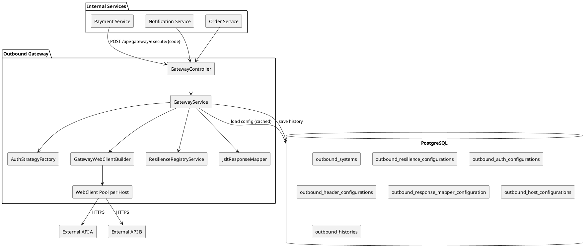
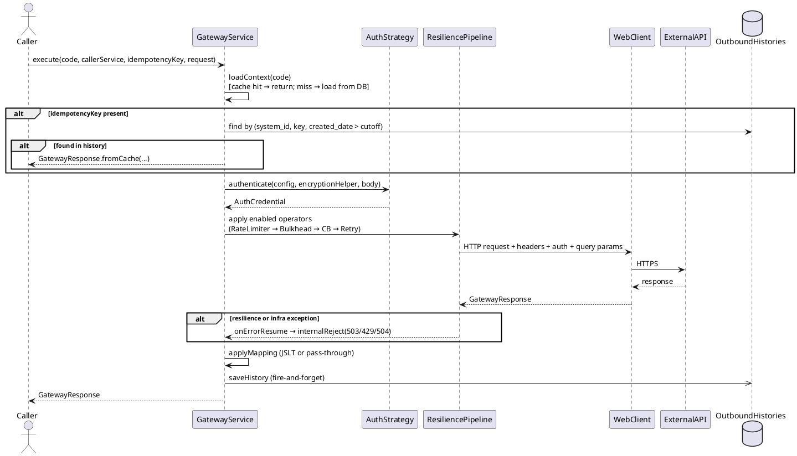
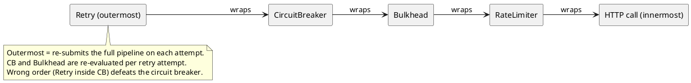
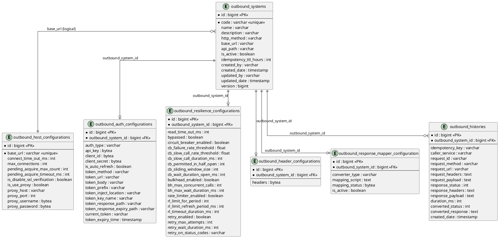

# Outbound Gateway

A centralized reactive microservice (Spring Boot 3.5 WebFlux + R2DBC PostgreSQL) that acts as the single egress point from internal services to external APIs.

All configuration is stored in the database — no restart is needed to add, update, or toggle outbound systems.

---

## Features & Capabilities

| Feature | Detail |
|---|---|
| **Auth strategies** | None, API Key, Basic, Bearer Static, OAuth2 Client Credentials, HMAC-SHA256, RSA |
| **Resilience** | Circuit Breaker, Bulkhead, Rate Limiter, Retry — per system, independently opt-in |
| **Response mapping** | JSLT transform — pass-through when not configured |
| **Encryption** | AES-256-GCM for all sensitive fields (api_key, client_secret, proxy credentials) |
| **Idempotency** | Per outbound system, TTL configurable, backed by DB history |
| **History** | Every call saved to `outbound_histories` including internal rejects |
| **Connection pool** | Per-host Reactor Netty pool with configurable size and acquire timeout |
| **HTTP logging** | Logbook logs all outbound request/response pairs |
| **Metrics** | Custom outbound call/duration/idempotency counters + Resilience4j auto-binding via Micrometer + Prometheus |

---

## Architecture



### Connection Pool Design

One Reactor Netty connection pool per `baseUrl` (scheme+host+port), shared across all outbound systems pointing to the same host.

```
webClientCache (one pool per host)
  "https://api.xendit.co"
      ├── /v1/charges   → system "xendit-charge"   (CB + Bulkhead)
      └── /v1/refunds   → system "xendit-refund"   (CB only)
  "https://api.midtrans.com"
      └── /v2/charge    → system "midtrans-charge" (Rate Limiter + Retry)
```

---

## Execution Flow



### Resilience Pipeline Order



Only mechanisms with their enable flag set to `true` are applied. A system with no enabled mechanisms runs with only the read timeout.

---

## Tech Stack

| Layer | Library / Version |
|---|---|
| **Runtime** | Java 21, Spring Boot 3.5.0 |
| **Web** | Spring WebFlux (Reactor Netty) |
| **Database (reactive)** | Spring Data R2DBC, r2dbc-postgresql |
| **Database (migrations)** | Flyway Core + flyway-database-postgresql |
| **Database (JDBC)** | PostgreSQL JDBC (Flyway only) |
| **Resilience** | Resilience4j 2.3.0 (spring-boot3, reactor, micrometer) |
| **HTTP logging** | Zalando Logbook 3.12.3 (spring-webflux, netty, json) |
| **Tracing** | Micrometer Tracing (Brave bridge), Zipkin Brave SLF4J |
| **Metrics** | Micrometer Prometheus registry |
| **JSON transform** | JSLT 0.1.14 |
| **ID generation** | TSID Creator 5.2.6 |
| **Serialization** | Jackson (via Spring Boot), Gson 2.13.2 |
| **Caching** | Caffeine (via Spring Boot Cache) |
| **Logging** | Log4j2 (async via LMAX Disruptor 3.4.4) |
| **Testing** | JUnit 5, Reactor Test, r2dbc-h2, WireMock 3.13.1, Awaitility 4.3.0, Micrometer Observation/Tracing Test |

---

## How to Setup

### Prerequisites

- Java 21+
- PostgreSQL 14+
- Maven 3.9+

### Environment Variables

> **`GATEWAY_ENCRYPTION_KEY` is the only required variable with no default.** All others have working defaults for local development.

| Variable | Description | Default | Required |
|---|---|---|---|
| `GATEWAY_ENCRYPTION_KEY` | AES-256-GCM key — Base64-encoded 32 bytes | — | **Yes** |
| `R2DBC_URL` | R2DBC connection URL (reactive) | `r2dbc:postgresql://localhost:5432/boilerplate` | No |
| `DB_USERNAME` | Database username | `user` | No |
| `DB_PASSWORD` | Database password | `password` | No |
| `DB_URL` | JDBC URL (used only by Flyway) | `jdbc:postgresql://localhost:5432/boilerplate` | No |
| `FLYWAY_ENABLED` | Whether Flyway runs migrations on startup | `false` | No |
| `SERVER_PORT` | Application HTTP port | `8080` | No |
| `ACTUATOR_PORT` | Management/actuator port | `1000` | No |
| `CONTEXT_PATH` | WebFlux base path prefix | `/app` | No |
| `DB_POOL_SIZE` | R2DBC pool initial size | `5` | No |
| `DB_MAX_POOL_SIZE` | R2DBC pool max size | `10` | No |
| `TRACING_SAMPLING_PROBABILITY` | Micrometer tracing sample rate (0.0–1.0) | `1.0` | No |
| `ROOT_LOG_LEVEL` | Root log level | `INFO` | No |
| `APP_LOG_LEVEL` | Application log level | `INFO` | No |
| `APPS_LOG_FORMAT` | Log format (`json` or `console`) | `json` | No |
| `APP_NAME` | Spring application name | `outbound-gateway` | No |
| `APP_VERSION` | Application version label | `1.0.0` | No |

Generate a 32-byte key:
```bash
openssl rand -base64 32
```

### Run Locally

```bash
mvn spring-boot:run -DGATEWAY_ENCRYPTION_KEY=<your-base64-key>
```

> **Flyway is disabled by default** (`FLYWAY_ENABLED=false`). To apply migrations on startup, set `FLYWAY_ENABLED=true`. Without it, apply the SQL files in `src/main/resources/db/migration/` manually (V1 through V19).

All API paths are served under the base path configured by `CONTEXT_PATH` (default `/app`). A request to execute a gateway call is:

```
POST http://localhost:8080/app/api/gateway/execute/{code}
```

Actuator endpoints are on a **separate port** (default `1000`, controlled by `ACTUATOR_PORT`):

```
GET http://localhost:1000/actuator/health
GET http://localhost:1000/actuator/prometheus
```

---

## Configuration Guide

### Primary: Admin API

The recommended way to configure outbound systems is through the Admin API — the gateway encrypts sensitive fields automatically and validates input before writing to the database.

#### Step 1 — Create an outbound system

```
POST /api/outbound
```

```json
{
  "code": "xendit-charge",
  "name": "Xendit Charge",
  "description": "Create payment charge",
  "httpMethod": "POST",
  "baseUrl": "https://api.xendit.co",
  "apiPath": "/v2/charges",
  "isActive": true,
  "idempotencyTtlHours": 24
}
```

#### Step 2 — Configure resilience

```
POST /api/outbound/{code}/resilience
```

`circuitBreaker`, `bulkHead`, `rateLimiter`, and `retry` are optional sub-objects. Omit (or send `null`) to disable that mechanism. `readTimeOutMs` is always required (minimum 1).

**Circuit Breaker + Retry only**

```json
{
  "readTimeOutMs": 10000,
  "circuitBreaker": {
    "cbFailureRateThreshold": 50.0,
    "cbSlowCallRateThreshold": 100.0,
    "cbSlowCallDurationMs": 5000,
    "cbPermittedInHalfOpen": 10,
    "cbSlidingWindowSize": 50,
    "cbWaitDurationOpenMs": 30000
  },
  "retry": {
    "retryMaxAttempts": 3,
    "retryWaitDurationMs": 500,
    "retryOnStatusCodes": ["500", "502", "503"]
  }
}
```

**Bulkhead only**

```json
{
  "readTimeOutMs": 10000,
  "bulkHead": {
    "bhMaxConcurrentCalls": 20,
    "bhMaxWaitDurationMs": 0
  }
}
```

**All four mechanisms**

```json
{
  "readTimeOutMs": 10000,
  "circuitBreaker": {
    "cbFailureRateThreshold": 50.0,
    "cbSlowCallRateThreshold": 100.0,
    "cbSlowCallDurationMs": 5000,
    "cbPermittedInHalfOpen": 10,
    "cbSlidingWindowSize": 50,
    "cbWaitDurationOpenMs": 30000
  },
  "bulkHead": {
    "bhMaxConcurrentCalls": 20,
    "bhMaxWaitDurationMs": 0
  },
  "rateLimiter": {
    "rlLimitForPeriod": 100,
    "rlLimitRefreshPeriodMs": 1000,
    "rlTimeoutDurationMs": 0
  },
  "retry": {
    "retryMaxAttempts": 3,
    "retryWaitDurationMs": 500,
    "retryOnStatusCodes": ["500", "502", "503"]
  }
}
```

**Read timeout only** — send `readTimeOutMs` with no sub-objects:

```json
{
  "readTimeOutMs": 10000
}
```

**No resilience at all** — omit the row entirely. The system runs with no operators and no timeout.

#### Step 3 — Configure auth

```
POST /api/outbound/{code}/auth
```

Sensitive fields (`apiKey`, `clientId`, `clientSecret`) are AES-256-GCM encrypted by the gateway before storage. Send raw plaintext values — never pre-encrypted bytes.

**API Key**

```json
{
  "authType": "API_KEY",
  "apiKey": "my-raw-secret-key",
  "tokenInjectLocation": "HEADER",
  "tokenKeyName": "Authorization"
}
```

**OAuth2 Client Credentials**

```json
{
  "authType": "OAUTH",
  "clientId": "my-client-id",
  "clientSecret": "my-client-secret",
  "isAutoRefresh": true,
  "tokenMethod": "POST",
  "tokenUrl": "https://auth.example.com/token",
  "tokenBody": "grant_type=client_credentials",
  "tokenPrefix": "Bearer",
  "tokenInjectLocation": "HEADER",
  "tokenKeyName": "Authorization",
  "tokenResponsePath": "$.access_token",
  "tokenResponseExpiryPath": "$.expires_in"
}
```

#### Step 4 — Configure static headers (optional)

```
POST /api/outbound/{code}/headers
```

```json
{
  "headers": {
    "Content-Type": ["application/json"],
    "Accept": ["application/json"]
  }
}
```

#### Step 5 — Configure response mapping (optional)

```
POST /api/outbound/{code}/response-mapper
```

```json
{
  "converterType": "JSLT",
  "mappingScript": "{\"transactionId\": .id, \"amount\": .amount, \"status\": .status}",
  "mappingStatus": { "404": 400, "422": 400 },
  "isActive": true
}
```

---

### Alternative: Direct SQL

Use this approach for bulk seeding or when the Admin API is unavailable.

> **Warning**: Sensitive fields (`api_key`, `client_id`, `client_secret`, `proxy_username`, `proxy_password`) must be AES-256-GCM encrypted before insertion. JSON config columns (headers, response mapper `mapping_status`) must be cast to `bytea`.

**Register a system**

```sql
INSERT INTO outbound_systems (code, name, description, http_method, base_url, api_path, is_active, idempotency_ttl_hours)
VALUES ('xendit-charge', 'Xendit Charge', 'Create payment charge', 'POST',
        'https://api.xendit.co', '/v2/charges', true, 24);
```

**Configure the host connection pool (optional — defaults apply)**

```sql
INSERT INTO outbound_host_configurations
    (base_url, connect_time_out_ms, max_connections, pending_acquire_max_count,
     pending_acquire_timeout_ms, is_disable_ssl_verification, is_use_proxy)
VALUES ('https://api.xendit.co', 5000, 200, 500, 5000, false, false);
```

> **Invariant**: `pending_acquire_timeout_ms` MUST be less than `read_time_out_ms` of all systems on this host.
> **Invariant**: `max_connections` MUST be >= the sum of `bh_max_concurrent_calls` across all systems on this host.

Defaults when no row exists: `connectTimeOutMs=5000`, `maxConnections=500`, `pendingAcquireMaxCount=1000`, `pendingAcquireTimeoutMs=30000`.

**Configure static headers**

```sql
INSERT INTO outbound_header_configurations (outbound_system_id, headers)
VALUES (
    (SELECT id FROM outbound_systems WHERE code = 'xendit-charge'),
    '{"Content-Type": ["application/json"], "Accept": ["application/json"]}'::bytea
);
```

**Configure response mapping**

```sql
INSERT INTO outbound_response_mapper_configuration
    (outbound_system_id, converter_type, mapping_script, mapping_status, is_active)
VALUES (
    (SELECT id FROM outbound_systems WHERE code = 'xendit-charge'),
    'JSLT',
    '{"transactionId": .id, "amount": .amount, "status": .status}',
    '{"404": 400, "422": 400}'::bytea,
    true
);
```

---

## Auth Strategy Reference

| Type | Required fields | Token location |
|---|---|---|
| `NONE` | — | — |
| `API_KEY` | `api_key`, `token_key_name`, `token_inject_location` | HEADER / QUERY_PARAM / COOKIE |
| `BASIC` | `client_id`, `client_secret` | HEADER (`Authorization: Basic ...`) |
| `BEARER_STATIC` | `api_key`, `token_prefix` | HEADER (`Authorization: <prefix> ...`) |
| `OAUTH` | `client_id`, `client_secret`, `token_url`, `token_method`, `token_body`, `token_prefix`, `token_inject_location`, `token_key_name`, `token_response_path`, `token_response_expiry_path` | Configurable |
| `HMAC` | `client_id` (key id), `client_secret` (signing key), `token_key_name` | HEADER |
| `RSA` | `api_key` (RSA private key, PEM format), `token_key_name` | HEADER |

All sensitive fields are stored as AES-256-GCM encrypted `bytea`.

---

## Resilience Reference

### Mechanism Combinations

| Use case | CB | Bulkhead | Rate Limiter | Retry |
|---|---|---|---|---|
| Protect against upstream instability | ✅ | | | ✅ |
| Limit concurrent calls only | | ✅ | | |
| Throttle outbound traffic | | | ✅ | |
| Full protection | ✅ | ✅ | ✅ | ✅ |
| Read timeout only | | | | |
| No protection (no row) | | | | |

### Two-Level Bypass Model

| Config state | Behavior |
|---|---|
| No row in `outbound_resilience_configurations` | Full bypass — no operators, no timeout |
| Row exists, all sub-objects omitted/null | Timeout applied; no resilience operators |
| Row exists, one or more sub-objects present | Full pipeline: RateLimiter → Bulkhead → CB → Retry (only present sub-objects) |

### Retry on Result

Retry triggers on **HTTP status codes** (configured via `retryOnStatusCodes`), not on thrown exceptions. Resilience4j's `retryOnResult` is used — a `503` response from the upstream causes a retry attempt without requiring a thrown exception.

### Internal Reject Status Codes

| Exception | HTTP Status | Reason |
|---|---|---|
| `BulkheadFullException` | 503 | Too many concurrent calls to this system |
| `CallNotPermittedException` | 503 | Circuit breaker is OPEN |
| `RequestNotPermitted` | 429 | Rate limit exceeded |
| `MaxRetriesExceededException` | 502 | Upstream repeatedly failed after all retry attempts |
| `TimeoutException` | 504 | Upstream did not respond within `read_time_out_ms` |
| Other | 503 | Unexpected internal error |

All internal rejects are saved to `outbound_histories` with the reject reason as `response_payload`.

---

## Observability

### Actuator Endpoints

Actuator runs on a **separate port** (default `1000`, controlled by `ACTUATOR_PORT`):

```
GET http://localhost:1000/actuator/health
GET http://localhost:1000/actuator/prometheus
GET http://localhost:1000/actuator/metrics
```

### Custom Outbound Metrics

Recorded by `OutboundMetricsRecorder` into Micrometer on every gateway call:

```
outbound_calls_total{code, http_status, caller_service}
outbound_calls_duration_seconds{code, quantile}
outbound_idempotency_hits_total{code}
```

- `code` — outbound system code (e.g. `xendit-charge`)
- `http_status` — actual upstream HTTP status, or `503`/`429`/`504` for internal rejects
- `caller_service` — from `X-Caller-Service` header; `"unknown"` when absent

### Resilience4j Prometheus Metrics

All Resilience4j instances are automatically bound to Micrometer via shared registries. Every system that has a mechanism enabled is tracked without manual registration:

```
resilience4j_circuitbreaker_state{name="<code>"}
resilience4j_circuitbreaker_failure_rate{name="<code>"}
resilience4j_circuitbreaker_calls_total{name="<code>",kind="successful|failed|not_permitted"}
resilience4j_bulkhead_available_concurrent_calls{name="<code>"}
resilience4j_ratelimiter_available_permissions{name="<code>"}
resilience4j_retry_calls{name="<code>",kind="successful_without_retry|successful_with_retry|failed_with_retry|failed_without_retry"}
```

### HTTP Logging (Logbook)

All outbound request/response pairs are logged by Logbook via the Netty pipeline. Configure in `application.yml`:

```yaml
logbook:
  filter.enabled: true
  format.style: json
```

### Distributed Tracing

`X-Client-Id` and `X-Request-Id` headers are propagated as Brave baggage fields and correlated into every log line. Set `TRACING_SAMPLING_PROBABILITY=0.1` in production to sample 10% of requests instead of all.

---

## Operational Rules

### Pool Sizing (must enforce)

| Rule | Consequence if violated |
|---|---|
| `pending_acquire_timeout_ms` < `read_time_out_ms` (all systems on same host) | Pool exhaustion appears as 504 timeout instead of 503 — wrong alert fires |
| `max_connections` >= sum of `bh_max_concurrent_calls` (all systems on same host) | Pool becomes the real bottleneck; bulkhead metric shows no saturation |

### Hot Reload

```
POST /api/outbound/{code}/reload
```

Evicts the context cache and the WebClient pool for the system's host. The next request reloads config from DB and creates a fresh connection pool.

> Evicting a pool drops ALL in-flight connections to that host — all systems sharing the same `baseUrl` are affected, not just the reloaded code.

### Encryption Key Rotation

`GATEWAY_ENCRYPTION_KEY` encrypts all sensitive fields. To rotate:

1. Re-encrypt all sensitive fields in DB (`api_key`, `client_id`, `client_secret`, `proxy_username`, `proxy_password`) with the new key.
2. Update the environment variable.
3. Restart the service.

There is no automatic migration — rotation is a manual data step.

### OAuth Token Persistence

OAuth tokens are cached in memory per auth config and written back to `outbound_auth_configurations.current_token` after each successful refresh. On service restart, the persisted token is loaded from DB, reducing cold-start token fetches for long-lived tokens.

### Context Cache and Thundering-Herd Protection

`GatewayServiceImpl` maintains a two-layer cache:

| Layer | Purpose |
|---|---|
| `contextCache` (hot path) | Returns the cached `OutboundSystemContext` immediately for warm keys |
| `contextLoadCache` (cold path) | Uses `Mono.cache()` to deduplicate concurrent DB loads — only one DB round-trip per key even under burst |

`doFinally` evicts the load cache entry after the DB load completes (success or error), preventing stale `Mono` objects from persisting. The hot cache is evicted explicitly via `POST /api/outbound/{code}/reload`.

### Resilience Config After V18 + V19 Migrations

V18 added four boolean enable flags (`circuit_breaker_enabled`, `bulkhead_enabled`, `rate_limiter_enabled`, `retry_enabled`) defaulting to `false`. V19 renamed those columns (removed the `is_` prefix) to match the R2DBC entity field names.

After these migrations all existing rows have all four flags set to `false`. Previously configured mechanisms are disabled by default. Admins must explicitly re-enable each mechanism. This is intentional — silently applying unvalidated thresholds is worse than running unprotected.

### Security Hardening Applied

| Issue | Fix |
|---|---|
| **Error message leakage** | `ApiExceptionHandler` returns fixed safe strings — `ex.getMessage()` is never forwarded to callers; SQL text is scrubbed from distributed traces |
| **Header injection** | `AppFilter` reflects only three whitelisted headers (`X-Request-Id`, `X-Client-Id`, `X-Request-Time`) to the response — not all request headers |
| **Sensitive value in logs** | Idempotency keys and internal identifiers no longer appear in exception messages that reach log aggregators |
| **Connection pool race** | `GatewayWebClientBuilder` uses `ConcurrentHashMap.computeIfAbsent` (atomic, factory called once) instead of `putIfAbsent` (could build two Netty pools concurrently) |
| **Reactor Context immutability** | `RetryHelper` and `ReactorJobExecutor` were discarding `context.put()` return values — all contextual keys were silently lost; fixed by chaining puts and returning the new `Context` |
| **Proxy no-op** | `GatewayWebClientBuilder` proxy lambda was creating a standalone `ProxyProvider.Builder` and discarding it — `useProxy=true` hosts were connecting direct; fixed by chaining on the `TypeSpec` parameter |

---

## Database Migrations

Flyway migrations live in `src/main/resources/db/migration/`. Enable with `FLYWAY_ENABLED=true`.

| Version | Description |
|---|---|
| V1 | Initial schema — `outbound_systems` |
| V2–V5 | Sub-config tables: host, resilience, auth, headers |
| V6 | Response mapper configuration |
| V7 | `outbound_histories` table |
| V8–V11 | Index additions and constraint fixes |
| V12–V14 | Auth fields: `token_prefix`, `token_response_path`, `token_response_expiry_path`, `current_token` |
| V15–V17 | HMAC/RSA support columns |
| V18 | Add four boolean enable flags to `outbound_resilience_configurations` (default `false`) |
| V19 | Rename enable flag columns — remove `is_` prefix to match R2DBC entity field names |

---

## Database Schema (ERD)

> Render with [plantuml.com](https://www.plantuml.com/plantuml/uml/), the IntelliJ **PlantUML Integration** plugin, or the VS Code **PlantUML** extension. GitHub does not render PlantUML natively.



**Relationship notes:**
- Each `outbound_systems` row has at most one row in each sub-config table (auth, resilience, headers, response mapper). Missing sub-config rows mean: no auth (passthrough), no resilience (bypass), no static headers, no response mapper.
- `outbound_host_configurations` is keyed by `base_url`, not by `outbound_system_id`. Multiple outbound systems sharing the same `base_url` share the same host-level connection pool config.
- `outbound_histories` accumulates one row per gateway call (fire-and-forget, not transactional with the call itself).
- `bytea` columns (`api_key`, `client_id`, `client_secret`, `proxy_username`, `proxy_password`, `headers`, `mapping_status`) are encrypted with AES-256-GCM or serialized via custom R2DBC converters.

---

## API Endpoints

> **Base path**: All paths below are relative to the base path. With defaults, prepend `http://localhost:8080/app`.
> Example: `POST /api/gateway/execute/{code}` → `POST http://localhost:8080/app/api/gateway/execute/{code}`

All endpoints require these request headers:

| Header | Required | Description |
|---|---|---|
| `X-Client-Id` | Yes | Caller's client ID — used for request tracing |
| `X-Request-Id` | Yes | Unique request ID — used to correlate logs end-to-end |
| `X-Request-Time` | Yes | Request timestamp in ISO-8601 format (e.g. `2026-05-20T08:00:00+07:00`) |

---

### Gateway API

#### `POST /api/gateway/execute/{code}`

Executes an outbound HTTP call through the configured outbound system.

**Additional Headers**

| Header | Required | Description |
|---|---|---|
| `X-Caller-Service` | No | Name of the calling service — saved to history for auditing |
| `X-Idempotency-Key` | No | If provided, checks history first; returns cached result if found within TTL |
| `Content-Type` | Yes | `application/json` |

**Request body**

```json
{
  "queryParams": { "currency": "IDR" },
  "body": { "amount": 100000, "externalId": "order-123" }
}
```

Both fields are optional. `body` is a JSON object serialized by Jackson before being forwarded to the external system.

**Response** — always HTTP 200; actual external status is in `data.convertedStatus`

```json
{
  "response": { "code": "000", "description": "success", "time": "2026-05-19T08:00:00+07:00" },
  "data": {
    "status": 200,
    "headers": { "Content-Type": ["application/json"] },
    "body": { "id": "charge-abc", "status": "PENDING" },
    "convertedStatus": 200,
    "convertedResponse": { "id": "charge-abc", "status": "PENDING" },
    "fromCache": false
  }
}
```

`body` and `convertedResponse` are parsed JSON objects when the upstream returns valid JSON, or a plain string otherwise.

When blocked by a resilience mechanism:

```json
{
  "response": { "code": "000", "description": "success" },
  "data": {
    "status": 503,
    "headers": {},
    "body": "service unavailable - circuit open",
    "convertedStatus": 503,
    "convertedResponse": "service unavailable - circuit open",
    "fromCache": false
  }
}
```

HTTP 400 when system code is not found or inactive:

```json
{
  "response": { "code": "400", "description": "bad request" },
  "error": { "violations": { "code": ["NotFound"] } }
}
```

---

#### `GET /api/gateway/histories`

Returns a paginated list of outbound call history.

**Query parameters**

| Param | Type | Default | Description |
|---|---|---|---|
| `code` | String | — | Filter by outbound system code. Omit to query all systems |
| `startDate` | ISO-8601 datetime | — | Lower bound on `created_date` (e.g. `2026-05-01T00:00:00`) |
| `endDate` | ISO-8601 datetime | — | Upper bound on `created_date` |
| `status` | Integer | — | Filter by `response_status` (e.g. `500`) |
| `page` | Integer | `0` | Zero-based page number |
| `size` | Integer | `20` | Page size |

**Response**

```json
{
  "response": { "code": "000", "description": "success" },
  "data": {
    "content": [
      {
        "id": 1,
        "outboundSystemId": 3,
        "idempotencyKey": "order-123",
        "callerService": "payment-service",
        "requestMethod": "POST",
        "requestUrl": "https://api.xendit.co/v2/charges",
        "requestPayload": { "amount": 100000, "externalId": "order-123" },
        "responseStatus": 200,
        "responsePayload": { "id": "charge-abc" },
        "durationMs": 342,
        "convertedStatus": 200,
        "convertedResponse": { "id": "charge-abc" },
        "createdDate": "2026-05-19T07:55:00"
      }
    ],
    "page": 0,
    "size": 20,
    "totalElements": 1,
    "totalPages": 1
  }
}
```

---

#### `GET /api/gateway/histories/{idempotencyKey}?code={code}`

Looks up a single history record by idempotency key. `code` is required because idempotency keys are scoped per outbound system.

Returns HTTP 400 if not found.

---

### Admin API

---

#### `POST /api/outbound`

Creates a new outbound system registration. See [Configuration Guide — Step 1](#step-1--create-an-outbound-system) for request and response shape.

---

#### `GET /api/outbound`

Returns all registered outbound systems.

---

#### `GET /api/outbound/{code}`

Returns full detail including all sub-configurations (resilience, headers, auth, response mapper).

```json
{
  "response": { "code": "000", "description": "success" },
  "data": {
    "id": 1,
    "code": "xendit-charge",
    "name": "Xendit Charge",
    "resilience": { "circuitBreakerEnabled": true, "retryEnabled": true, "retryMaxAttempts": 3 },
    "headers": { "Content-Type": ["application/json"] },
    "auth": { "authType": "API_KEY", "tokenKeyName": "Authorization", "tokenInjectLocation": "HEADER" },
    "responseMapper": { "converterType": "JSLT", "mappingScript": "...", "isActive": true }
  }
}
```

Auth response deliberately omits `api_key`, `client_id`, `client_secret` — encrypted values are never returned.

---

#### `PUT /api/outbound/{code}`

Updates `name`, `description`, `httpMethod`, `baseUrl`, `apiPath`, `isActive`, `idempotencyTtlHours`.

---

#### `DELETE /api/outbound/{code}`

Cascade-deletes the system and all sub-configs (resilience, headers, auth, response mapper). Returns `true` on success.

---

#### `POST /api/outbound/{code}/resilience`

See [Configuration Guide — Step 2](#step-2--configure-resilience) for request shape. Returns `true` on success.

---

#### `POST /api/outbound/{code}/headers`

See [Configuration Guide — Step 4](#step-4--configure-static-headers-optional) for request shape. Returns `true` on success.

---

#### `POST /api/outbound/{code}/auth`

See [Configuration Guide — Step 3](#step-3--configure-auth) for request shape.

Sensitive fields are encrypted by the gateway. Send raw plaintext — never pre-encrypted bytes. Returns `true` on success.

---

#### `POST /api/outbound/{code}/response-mapper`

See [Configuration Guide — Step 5](#step-5--configure-response-mapping-optional) for request shape. Returns `true` on success.

---

#### `POST /api/outbound/{code}/reload`

Evicts the context cache and WebClient pool for the system's host. The next request reloads config from DB and creates a fresh connection pool. Returns `true` on success.

> Evicting the pool drops **all in-flight connections to that host** — all systems sharing the same `baseUrl` are affected.

---

#### `POST /api/outbound/{code}/test`

Probes the outbound system's endpoint using the same `GatewayWebClientBuilder` pipeline.

**Response**

```json
{
  "response": { "code": "000", "description": "success" },
  "data": {
    "reachable": true,
    "latencyMs": 134,
    "httpStatus": 200
  }
}
```

---

#### `GET /api/outbound/{code}/metrics`

Returns real-time call statistics for the past hour from `outbound_histories`. Percentiles are computed with PostgreSQL `percentile_cont` (exact continuous interpolation, not approximation).

**Response**

```json
{
  "response": { "code": "000", "description": "success" },
  "data": {
    "code": "xendit-charge",
    "period": "last_1h",
    "totalCalls": 200,
    "successRate": 0.992,
    "errorRate": 0.008,
    "breakdownByStatus": {
      "200": { "count": 184, "percentage": 92.0 },
      "500": { "count": 2,   "percentage": 1.0  }
    },
    "avgDurationMs": 234,
    "p90DurationMs": 890,
    "p95DurationMs": 1102,
    "p99DurationMs": 1843,
    "circuitBreakerState": "CLOSED",
    "idempotencyHits": 12
  }
}
```

When `totalCalls = 0`, all percentiles return `0`.

---

## Error Response Reference

| Exception | HTTP Status | `violations` key | Value |
|---|---|---|---|
| `NoResourceFoundException` | 400 | `endpoint` | `["not available"]` |
| `EmissionException` | 400 | `publisher` | Reactor sink failure reason |
| `HandlerMethodValidationException` | 400 | parameter name | `["NotValid"]` |
| `ConstraintViolationException` | 400 | field path | validation message |
| `OutboundSystemNotFoundException` | 400 | `code` | `["NotFound"]` |
| `IllegalArgumentException` | 400 | `message` | `["Bad request"]` |
| `BadSqlGrammarException` | 500 | `exception` | `["database error"]` |
| Any other `Throwable` | 500 | `exception` | `["Internal server error"]` |

All error responses use the same envelope:

```json
{
  "response": { "code": "400", "description": "bad request" },
  "error": { "violations": { "<key>": ["<message>"] } }
}
```

Exception details are logged server-side. No internal message, stack trace, or SQL ever reaches the caller.

---

## Testing

### Running Tests

```bash
# All tests
mvn test

# Single test class
mvn test -Dtest=GatewayExecuteAuthIntegrationTest

# All integration tests (by pattern)
mvn test -Dtest="*IntegrationTest,*PermutationTest"
```

### Integration Test Architecture

All integration tests extend `BaseIntegrationTest`, which:
- Starts a full Spring Boot application on a random port (`DEFINED_PORT` + `@AutoConfigureWebTestClient`)
- Uses H2 in-memory R2DBC database with the schema from `src/test/resources/schema.sql`
- Registers H2-compatible converters (`PGByteArrayToMapConverter`, `PGByteArrayToIntegerMapConverter`, `PGMapToByteArrayConverter`) in place of the PostgreSQL JSON converters
- Disables Flyway and cron jobs

WireMock (`dynamicPort()`) is used as a fake external API server in tests that call outbound HTTP endpoints.

### Test Suite Overview

| Test class | Tests | What it covers |
|---|---|---|
| `GatewayControllerIntegrationTest` | 3 | Basic execute happy path, idempotency, query-param forwarding |
| `GatewayExecuteAuthIntegrationTest` | 7 | All 7 auth strategies end-to-end via WireMock header verification |
| `GatewayExecuteResilienceIntegrationTest` | 5 | Circuit Breaker (forced open), Bulkhead (slot exhausted), Rate Limiter, Retry (exhausted), Read Timeout |
| `GatewayExecuteResponseMapperIntegrationTest` | 4 | No mapper passthrough, JSLT transform, JSLT + status remap, inactive mapper |
| `GatewayExecuteValidationIntegrationTest` | 5 | Inactive system, history persistence, upstream 4xx passthrough, null body, query params |
| `GatewayHistoryControllerIntegrationTest` | 13 | Paginated list, filter by code/status/date, idempotency key lookup, all response fields |
| `AdminOutboundControllerIntegrationTest` | 13 | Full CRUD, upsert all sub-configs, reload, test-connection, metrics (zero + seeded) |
| `AdminGatewayFlowPermutationTest` | 6 | End-to-end permutations: full flow, idempotency, active/inactive toggle, reload, batch metrics |
| `GatewayExecuteFullPipelineIntegrationTest` | 4 | Combined pipelines: API_KEY+Retry+header+JSLT; BASIC+CB+header; Bearer+RateLimit+header; OAuth+bypass+header+JSLT |
| `TestControllerIntegrationTest` | 1 | Health-check endpoint |

**Total: 61 integration test methods**

Additional unit tests cover:

| Test class | What it covers |
|---|---|
| `AuthStrategyTest` | Each auth strategy in isolation with mocked dependencies |
| `GatewayHistoryServiceTest` | History service pagination and filter logic |
| `GatewayWebClientBuilderTest` | WebClient pool creation, proxy config, SSL override |
| `GatewayServiceIntegrationTest` | Context cache, eviction, thundering-herd dedup |
| `GatewayMetricsIntegrationTest` | Custom Micrometer counters and timers |
| `ResilienceRegistryServiceTest` | Registry CRUD, metric binding |
| `OutboundHistoryRepositoryFilterTest` | Custom SQL filter query with all parameter combinations |
| `OutboundMetricsRecorderTest` | Percentile computation from seeded history rows |
| `EncryptionHelperTest` | AES-256-GCM round-trip, encrypt/decrypt |
| `JsltResponseMapperTest` | JSLT transform and Caffeine expression cache |

### Key Test Patterns

**Async history saves** — History is saved fire-and-forget after each gateway call. Tests that assert history row count use Awaitility:

```java
Awaitility.await()
    .atMost(Duration.ofSeconds(5))
    .pollInterval(Duration.ofMillis(200))
    .until(() -> historyRepository.count().block() >= 1L);
```

**Stateful WireMock (Retry tests)** — Use WireMock Scenarios to return different responses on consecutive calls to the same endpoint:

```java
wireMock.stubFor(post(urlEqualTo("/endpoint"))
    .inScenario("retry-test")
    .whenScenarioStateIs(Scenario.STARTED)
    .willReturn(aResponse().withStatus(500))
    .willSetStateTo("SUCCESS"));

wireMock.stubFor(post(urlEqualTo("/endpoint"))
    .inScenario("retry-test")
    .whenScenarioStateIs("SUCCESS")
    .willReturn(aResponse().withStatus(200)));
```

**Resilience4j context isolation** — Tests call `gatewayService.evictContext(code)` and `resilienceRegistryService.reload(code)` in `@AfterEach` to prevent registry state from leaking across test methods.
