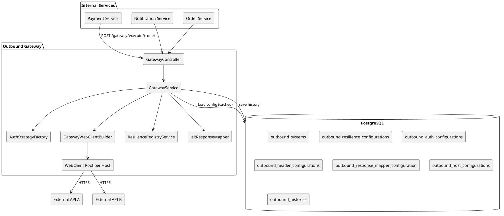
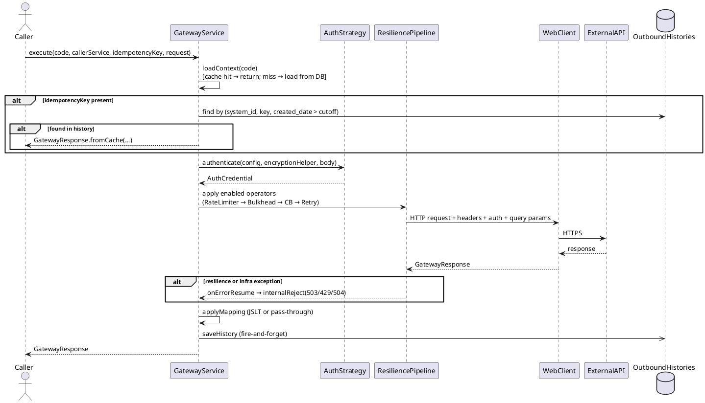
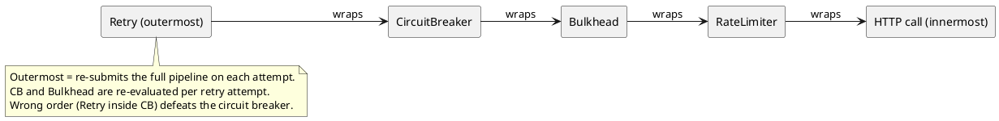

# Outbound Gateway

A centralized reactive microservice (Spring Boot 3.5 WebFlux + R2DBC PostgreSQL) that acts as the single egress point from internal services to external APIs.

All configuration is stored in the database — no restart is needed to add, update, or toggle outbound systems.

---

## Features & Capabilities

| Feature | Detail |
|---|---|
| **Auth strategies** | None, API Key, Basic, Bearer Static, OAuth2 Client Credentials, HMAC-SHA256, RSA |
| **Resilience** | Circuit Breaker, Bulkhead, Rate Limiter, Retry — per system, independently opt-in |
| **Response mapping** | JSLT transform — pass-through when not configured |
| **Encryption** | AES-256-GCM for all sensitive fields (api_key, client_secret, proxy credentials) |
| **Idempotency** | Per outbound system, TTL configurable, backed by DB history |
| **History** | Every call saved to `outbound_histories` including internal rejects |
| **Connection pool** | Per-host Reactor Netty pool with configurable size and acquire timeout |
| **HTTP logging** | Logbook logs all outbound request/response pairs |
| **Metrics** | Custom outbound call/duration/idempotency counters + Resilience4j auto-binding via Micrometer + Prometheus |

---

## Architecture



### Connection Pool Design

One Reactor Netty connection pool per `baseUrl` (scheme+host+port), shared across all outbound systems pointing to the same host.

```
webClientCache (one pool per host)
  "https://api.xendit.co"
      ├── /v1/charges   → system "xendit-charge"   (CB + Bulkhead)
      └── /v1/refunds   → system "xendit-refund"   (CB only)
  "https://api.midtrans.com"
      └── /v2/charge    → system "midtrans-charge" (Rate Limiter + Retry)
```

---

## Execution Flow



### Resilience Pipeline Order



Only mechanisms with their enable flag set to `true` are applied. A system with no enabled mechanisms runs with only the read timeout.

---

## How to Setup

### Prerequisites

- Java 21+
- PostgreSQL 14+
- Maven 3.9+

### Environment Variables

| Variable | Description | Required |
|---|---|---|
| `GATEWAY_ENCRYPTION_KEY` | AES-256 key — Base64-encoded 32 bytes | Yes |
| `SPRING_R2DBC_URL` | R2DBC connection URL for reactive queries | Yes |
| `SPRING_R2DBC_USERNAME` | DB username | Yes |
| `SPRING_R2DBC_PASSWORD` | DB password | Yes |
| `SPRING_FLYWAY_URL` | JDBC URL for Flyway migrations | Yes |
| `SPRING_FLYWAY_USER` | DB username for Flyway | Yes |
| `SPRING_FLYWAY_PASSWORD` | DB password for Flyway | Yes |

Generate a 32-byte key:
```bash
openssl rand -base64 32
```

### Run Locally

```bash
mvn spring-boot:run
```

Flyway runs automatically on startup and applies all pending migrations.

---

## Configuration Guide

### Step 1 — Register an outbound system

```sql
INSERT INTO outbound_systems (code, name, description, http_method, base_url, api_path, is_active, idempotency_ttl_hours)
VALUES ('xendit-charge', 'Xendit Charge', 'Create payment charge', 'POST',
        'https://api.xendit.co', '/v2/charges', true, 24);
```

### Step 2 — Configure the host connection pool (optional — defaults apply)

```sql
INSERT INTO outbound_host_configurations
    (base_url, connect_time_out_ms, max_connections, pending_acquire_max_count,
     pending_acquire_timeout_ms, is_disable_ssl_verification, is_use_proxy)
VALUES ('https://api.xendit.co', 5000, 200, 500, 5000, false, false);
```

> **Invariant**: `pending_acquire_timeout_ms` MUST be less than `read_time_out_ms` of all systems on this host.
> **Invariant**: `max_connections` MUST be >= the sum of `bh_max_concurrent_calls` across all systems on this host.

Defaults when no row exists: `connectTimeOutMs=5000`, `maxConnections=500`, `pendingAcquireMaxCount=1000`, `pendingAcquireTimeoutMs=30000`.

### Step 3 — Configure resilience (choose your combination)

Each mechanism is independently opt-in via a boolean flag. Only set `true` for mechanisms you want.

**Circuit Breaker + Retry only**

```sql
INSERT INTO outbound_resilience_configurations (
    outbound_system_id, read_time_out_ms,
    circuit_breaker_enabled,
    cb_failure_rate_threshold, cb_slow_call_rate_threshold, cb_slow_call_duration_ms,
    cb_permitted_in_half_open, cb_sliding_window_size, cb_wait_duration_open_ms,
    bulkhead_enabled,
    rate_limiter_enabled,
    retry_enabled,
    retry_max_attempts, retry_wait_duration_ms, retry_on_status_codes
) VALUES (
    (SELECT id FROM outbound_systems WHERE code = 'xendit-charge'),
    10000,
    true,  50, 100, 5000, 10, 50, 30000,
    false,
    false,
    true,  3, 500, '500,502,503'
);
```

**Bulkhead only**

```sql
INSERT INTO outbound_resilience_configurations (
    outbound_system_id, read_time_out_ms,
    circuit_breaker_enabled,
    bulkhead_enabled, bh_max_concurrent_calls, bh_max_wait_duration_ms,
    rate_limiter_enabled,
    retry_enabled
) VALUES (
    (SELECT id FROM outbound_systems WHERE code = 'xendit-charge'),
    10000, false, true, 20, 0, false, false
);
```

**All four mechanisms**

```sql
INSERT INTO outbound_resilience_configurations (
    outbound_system_id, read_time_out_ms,
    circuit_breaker_enabled,
    cb_failure_rate_threshold, cb_slow_call_rate_threshold, cb_slow_call_duration_ms,
    cb_permitted_in_half_open, cb_sliding_window_size, cb_wait_duration_open_ms,
    bulkhead_enabled, bh_max_concurrent_calls, bh_max_wait_duration_ms,
    rate_limiter_enabled, rl_limit_for_period, rl_limit_refresh_period_ms, rl_timeout_duration_ms,
    retry_enabled, retry_max_attempts, retry_wait_duration_ms, retry_on_status_codes
) VALUES (
    (SELECT id FROM outbound_systems WHERE code = 'xendit-charge'),
    10000,
    true,  50, 100, 5000, 10, 50, 30000,
    true,  20, 0,
    true,  100, 1000, 0,
    true,  3, 500, '500,502,503'
);
```

**Read timeout only (no resilience operators)**

```sql
INSERT INTO outbound_resilience_configurations (
    outbound_system_id, read_time_out_ms,
    circuit_breaker_enabled, bulkhead_enabled, rate_limiter_enabled, retry_enabled
) VALUES (
    (SELECT id FROM outbound_systems WHERE code = 'xendit-charge'),
    10000, false, false, false, false
);
```

**No resilience at all** — omit the row entirely. The system runs with no operators and no timeout.

### Step 4 — Configure auth

**API Key (header injection)**

```sql
-- Sensitive fields must be AES-256-GCM encrypted before insertion.
-- Use the Admin API POST /internal/outbound-systems/{code}/auth to let the gateway encrypt automatically.
INSERT INTO outbound_auth_configurations
    (outbound_system_id, auth_type, api_key, token_inject_location, token_key_name)
VALUES (
    (SELECT id FROM outbound_systems WHERE code = 'xendit-charge'),
    'API_KEY', '<encrypted-bytes>', 'HEADER', 'Authorization'
);
```

**OAuth2 Client Credentials**

```sql
INSERT INTO outbound_auth_configurations (
    outbound_system_id, auth_type, client_id, client_secret,
    is_auto_refresh, token_method, token_url, token_body,
    token_prefix, token_inject_location, token_key_name,
    token_response_path, token_response_expiry_path
) VALUES (
    (SELECT id FROM outbound_systems WHERE code = 'xendit-charge'),
    'OAUTH', '<encrypted-client-id>', '<encrypted-client-secret>',
    true, 'POST', 'https://api.xendit.co/oauth/token', 'grant_type=client_credentials',
    'Bearer', 'HEADER', 'Authorization', '$.access_token', '$.expires_in'
);
```

### Step 5 — Configure static headers (optional)

```sql
INSERT INTO outbound_header_configurations (outbound_system_id, headers)
VALUES (
    (SELECT id FROM outbound_systems WHERE code = 'xendit-charge'),
    '{"Content-Type": ["application/json"], "Accept": ["application/json"]}'::bytea
);
```

### Step 6 — Configure response mapping (optional)

```sql
INSERT INTO outbound_response_mapper_configuration
    (outbound_system_id, converter_type, mapping_script, mapping_status, is_active)
VALUES (
    (SELECT id FROM outbound_systems WHERE code = 'xendit-charge'),
    'JSLT',
    '{"transactionId": .id, "amount": .amount, "status": .status}',
    '{"404": 400, "422": 400}'::bytea,
    true
);
```

---

## Auth Strategy Reference

| Type | Required fields | Token location |
|---|---|---|
| `NONE` | — | — |
| `API_KEY` | `api_key`, `token_key_name`, `token_inject_location` | HEADER / QUERY_PARAM / COOKIE |
| `BASIC` | `client_id`, `client_secret` | HEADER (`Authorization: Basic ...`) |
| `BEARER_STATIC` | `api_key`, `token_prefix` | HEADER (`Authorization: <prefix> ...`) |
| `OAUTH` | `client_id`, `client_secret`, `token_url`, `token_method`, `token_body`, `token_prefix`, `token_inject_location`, `token_key_name`, `token_response_path`, `token_response_expiry_path` | Configurable |
| `HMAC` | `client_id` (key id), `client_secret` (signing key), `token_key_name` | HEADER |
| `RSA` | `api_key` (RSA private key, PEM format), `token_key_name` | HEADER |

All sensitive fields are stored as AES-256-GCM encrypted `bytea`.

---

## Resilience Reference

### Mechanism Combinations

| Use case | CB | Bulkhead | Rate Limiter | Retry |
|---|---|---|---|---|
| Protect against upstream instability | ✅ | | | ✅ |
| Limit concurrent calls only | | ✅ | | |
| Throttle outbound traffic | | | ✅ | |
| Full protection | ✅ | ✅ | ✅ | ✅ |
| Read timeout only | | | | |
| No protection (no row) | | | | |

### Internal Reject Status Codes

| Exception | HTTP Status | Reason |
|---|---|---|
| `BulkheadFullException` | 503 | Too many concurrent calls to this system |
| `CallNotPermittedException` | 503 | Circuit breaker is OPEN |
| `RequestNotPermitted` | 429 | Rate limit exceeded |
| `MaxRetriesExceededException` | 503 | Upstream repeatedly failed |
| `TimeoutException` | 504 | Upstream did not respond within `read_time_out_ms` |
| Other | 503 | Unexpected internal error |

All internal rejects are saved to `outbound_histories` with the reject reason as `response_payload`.

---

## Observability

### Actuator Endpoints

```
GET /actuator/health
GET /actuator/prometheus
GET /actuator/metrics
```

### Custom Outbound Metrics

Recorded by `OutboundMetricsRecorder` into Micrometer on every gateway call:

```
outbound_calls_total{code, http_status, caller_service}
outbound_calls_duration_seconds{code, quantile}
outbound_idempotency_hits_total{code}
```

- `code` — outbound system code (e.g. `xendit-charge`)
- `http_status` — actual upstream HTTP status, or `503`/`429`/`504` for internal rejects
- `caller_service` — from `X-Caller-Service` header; `"unknown"` when absent

### Resilience4j Prometheus Metrics

All Resilience4j instances are automatically bound to Micrometer via shared registries. Every system that has a mechanism enabled is tracked without manual registration:

```
resilience4j_circuitbreaker_state{name="<code>"}
resilience4j_circuitbreaker_failure_rate{name="<code>"}
resilience4j_circuitbreaker_calls_total{name="<code>",kind="successful|failed|not_permitted"}
resilience4j_bulkhead_available_concurrent_calls{name="<code>"}
resilience4j_ratelimiter_available_permissions{name="<code>"}
resilience4j_retry_calls{name="<code>",kind="successful_without_retry|successful_with_retry|failed_with_retry|failed_without_retry"}
```

### HTTP Logging (Logbook)

All outbound request/response pairs are logged by Logbook via the Netty pipeline. Configure in `application.yml`:

```yaml
logbook:
  filter.enabled: true
  format.style: json
```

---

## Operational Rules

### Pool Sizing (must enforce)

| Rule | Consequence if violated |
|---|---|
| `pending_acquire_timeout_ms` < `read_time_out_ms` (all systems on same host) | Pool exhaustion appears as 504 timeout instead of 503 — wrong alert fires |
| `max_connections` >= sum of `bh_max_concurrent_calls` (all systems on same host) | Pool becomes the real bottleneck; bulkhead metric shows no saturation |

### Hot Reload

```
POST /internal/outbound-systems/{code}/reload
```

Evicts the context cache and the WebClient pool for the system's host. The next request reloads config from DB and creates a fresh connection pool.

> Evicting a pool drops ALL in-flight connections to that host — all systems sharing the same `baseUrl` are affected, not just the reloaded code.

### Encryption Key Rotation

`GATEWAY_ENCRYPTION_KEY` encrypts all sensitive fields. To rotate:

1. Re-encrypt all sensitive fields in DB (`api_key`, `client_id`, `client_secret`, `proxy_username`, `proxy_password`) with the new key.
2. Update the environment variable.
3. Restart the service.

There is no automatic migration — rotation is a manual data step.

### OAuth Token Persistence

OAuth tokens are cached in memory per auth config and written back to `outbound_auth_configurations.current_token` after each successful refresh. On service restart, the persisted token is loaded from DB, reducing cold-start token fetches for long-lived tokens.

### Resilience Config After V18 + V19 Migrations

V18 added four boolean enable flags (`circuit_breaker_enabled`, `bulkhead_enabled`, `rate_limiter_enabled`, `retry_enabled`) defaulting to `false`. V19 renamed those columns (removed the `is_` prefix) to match the R2DBC entity mapping.

After these migrations all existing rows have all four flags set to `false`. Previously configured mechanisms are disabled by default. Admins must explicitly re-enable each mechanism. This is intentional — silently applying unvalidated thresholds is worse than running unprotected.

---

## API Endpoints

### Gateway API

#### `POST /gateway/execute/{code}`

Executes an outbound HTTP call through the configured outbound system.

**Headers**

| Header | Required | Description |
|---|---|---|
| `X-Client-Id` | Yes | Caller's client ID — used for request tracing and access control |
| `X-Request-Id` | Yes | Unique ID for this request — used to correlate logs end-to-end |
| `X-Request-Time` | Yes | Request timestamp in ISO-8601 format (e.g. `2026-05-20T08:00:00+07:00`) |
| `X-Caller-Service` | No | Name of the calling service — saved to history for auditing |
| `X-Idempotency-Key` | No | If provided, checks history first; returns cached result if found within TTL |
| `Content-Type` | Yes | `application/json` |

**Request body**

```json
{
  "queryParams": { "currency": "IDR" },
  "body": { "amount": 100000, "externalId": "order-123" }
}
```

Both fields are optional. `body` is a JSON object serialized by Jackson before being forwarded to the external system.

**Response** — always HTTP 200; actual external status is in `data.convertedStatus`

```json
{
  "response": { "code": "000", "description": "success", "time": "2026-05-19T08:00:00+07:00" },
  "data": {
    "status": 200,
    "headers": { "Content-Type": ["application/json"] },
    "body": { "id": "charge-abc", "status": "PENDING" },
    "convertedStatus": 200,
    "convertedResponse": { "id": "charge-abc", "status": "PENDING" },
    "fromCache": false
  }
}
```

`body` and `convertedResponse` are parsed JSON objects when the upstream returns valid JSON, or a plain string otherwise.

When blocked by a resilience mechanism:

```json
{
  "response": { "code": "000", "description": "success" },
  "data": {
    "status": 503,
    "headers": {},
    "body": "service unavailable - circuit open",
    "convertedStatus": 503,
    "convertedResponse": "service unavailable - circuit open",
    "fromCache": false
  }
}
```

HTTP 400 when system code is not found or inactive:

```json
{
  "response": { "code": "400", "description": "bad request" },
  "error": { "violations": { "message": ["Outbound system not found or inactive: unknown-code"] } }
}
```

---

#### `GET /gateway/histories`

Returns a paginated list of outbound call history.

**Query parameters**

| Param | Type | Default | Description |
|---|---|---|---|
| `code` | String | — | Filter by outbound system code. Omit to query all systems |
| `startDate` | ISO-8601 datetime | — | Lower bound on `created_date` (e.g. `2026-05-01T00:00:00`) |
| `endDate` | ISO-8601 datetime | — | Upper bound on `created_date` |
| `status` | Integer | — | Filter by `response_status` (e.g. `500`) |
| `page` | Integer | `0` | Zero-based page number |
| `size` | Integer | `20` | Page size, clamped to 1–100 |

**Response**

```json
{
  "response": { "code": "000", "description": "success" },
  "data": {
    "content": [
      {
        "id": 1,
        "outboundSystemId": 3,
        "idempotencyKey": "order-123",
        "callerService": "payment-service",
        "requestMethod": "POST",
        "requestUrl": "https://api.xendit.co/v2/charges",
        "requestPayload": { "amount": 100000, "externalId": "order-123" },
        "responseStatus": 200,
        "responsePayload": { "id": "charge-abc" },
        "durationMs": 342,
        "convertedStatus": 200,
        "convertedResponse": { "id": "charge-abc" },
        "createdDate": "2026-05-19T07:55:00"
      }
    ],
    "page": 0,
    "size": 20,
    "totalElements": 1,
    "totalPages": 1
  }
}
```

---

#### `GET /gateway/histories/{idempotencyKey}?code={code}`

Looks up a single history record by idempotency key. `code` is required because idempotency keys are scoped per outbound system.

**Response** — same shape as a single element from the list above (`requestPayload`, `responsePayload`, `convertedResponse` as parsed JSON objects), or HTTP 400 if not found.

---

### Admin API

All admin endpoints require the same mandatory request headers as the Gateway API (`X-Client-Id`, `X-Request-Id`, `X-Request-Time`).

---

#### `POST /internal/outbound-systems`

**Request**

```json
{
  "code": "xendit-charge",
  "name": "Xendit Charge",
  "description": "Create payment charge",
  "httpMethod": "POST",
  "baseUrl": "https://api.xendit.co",
  "apiPath": "/v2/charges",
  "isActive": true,
  "idempotencyTtlHours": 24
}
```

**Response**

```json
{
  "response": { "code": "000", "description": "success" },
  "data": {
    "id": 1,
    "code": "xendit-charge",
    "name": "Xendit Charge",
    "httpMethod": "POST",
    "baseUrl": "https://api.xendit.co",
    "apiPath": "/v2/charges",
    "isActive": true,
    "idempotencyTtlHours": 24
  }
}
```

---

#### `GET /internal/outbound-systems`

Returns all registered outbound systems.

---

#### `GET /internal/outbound-systems/{code}`

Returns full detail including all sub-configurations (resilience, headers, auth, response mapper).

```json
{
  "response": { "code": "000", "description": "success" },
  "data": {
    "id": 1,
    "code": "xendit-charge",
    "name": "Xendit Charge",
    "resilience": { "circuitBreakerEnabled": true, "retryEnabled": true, "retryMaxAttempts": 3 },
    "headers": { "Content-Type": ["application/json"] },
    "auth": { "authType": "API_KEY", "tokenKeyName": "Authorization", "tokenInjectLocation": "HEADER" },
    "responseMapper": { "converterType": "JSLT", "mappingScript": "...", "isActive": true }
  }
}
```

Auth response deliberately omits `api_key`, `client_id`, `client_secret` — encrypted values are never returned.

---

#### `PUT /internal/outbound-systems/{code}`

Updates `name`, `description`, `httpMethod`, `baseUrl`, `apiPath`, `isActive`, `idempotencyTtlHours`.

---

#### `DELETE /internal/outbound-systems/{code}`

Cascade-deletes the system and all sub-configs (resilience, headers, auth, response mapper). Returns `true` on success.

---

#### `POST /internal/outbound-systems/{code}/resilience`

**Request**

```json
{
  "readTimeOutMs": 10000,
  "circuitBreakerEnabled": true,
  "cbFailureRateThreshold": 50.0,
  "cbSlidingWindowSize": 50,
  "cbWaitDurationOpenMs": 30000,
  "bulkheadEnabled": false,
  "rateLimiterEnabled": false,
  "retryEnabled": true,
  "retryMaxAttempts": 3,
  "retryWaitDurationMs": 500,
  "retryOnStatusCodes": "500,502,503"
}
```

Returns `true` on success.

---

#### `POST /internal/outbound-systems/{code}/headers`

**Request**

```json
{
  "headers": {
    "Content-Type": ["application/json"],
    "Accept": ["application/json"]
  }
}
```

Returns `true` on success.

---

#### `POST /internal/outbound-systems/{code}/auth`

Sensitive fields (`apiKey`, `clientId`, `clientSecret`) are AES-256-GCM encrypted by the gateway before storage. Send raw plaintext values — never pre-encrypted bytes.

**Request (API Key)**

```json
{
  "authType": "API_KEY",
  "apiKey": "my-raw-secret-key",
  "tokenInjectLocation": "HEADER",
  "tokenKeyName": "Authorization"
}
```

**Request (OAuth2 Client Credentials)**

```json
{
  "authType": "OAUTH",
  "clientId": "my-client-id",
  "clientSecret": "my-client-secret",
  "isAutoRefresh": true,
  "tokenMethod": "POST",
  "tokenUrl": "https://auth.example.com/token",
  "tokenBody": "grant_type=client_credentials",
  "tokenPrefix": "Bearer",
  "tokenInjectLocation": "HEADER",
  "tokenKeyName": "Authorization",
  "tokenResponsePath": "$.access_token",
  "tokenResponseExpiryPath": "$.expires_in"
}
```

Returns `true` on success.

---

#### `POST /internal/outbound-systems/{code}/response-mapper`

**Request**

```json
{
  "converterType": "JSLT",
  "mappingScript": "{\"transactionId\": .id, \"amount\": .amount}",
  "mappingStatus": { "404": 400, "422": 400 },
  "isActive": true
}
```

Returns `true` on success.

---

#### `POST /internal/outbound-systems/{code}/reload`

Evicts the context cache and WebClient pool for the system's host. The next request reloads config from DB and creates a fresh connection pool.

Returns `true` on success.

> Evicting the pool drops **all in-flight connections to that host** — all systems sharing the same `baseUrl` are affected.

---

#### `POST /internal/outbound-systems/{code}/test`

Probes the outbound system's endpoint using the same `GatewayWebClientBuilder` pipeline.

**Response**

```json
{
  "response": { "code": "000", "description": "success" },
  "data": {
    "reachable": true,
    "latencyMs": 134,
    "httpStatus": 200
  }
}
```

---

#### `GET /internal/outbound-systems/{code}/metrics`

Returns real-time call statistics for the past hour from `outbound_histories`. Percentiles are computed with PostgreSQL `percentile_cont` (exact continuous interpolation, not approximation).

**Response**

```json
{
  "response": { "code": "000", "description": "success" },
  "data": {
    "code": "xendit-charge",
    "period": "last_1h",
    "totalCalls": 200,
    "successRate": 0.992,
    "errorRate": 0.008,
    "breakdownByStatus": {
      "200": { "count": 184, "percentage": 92.0 },
      "500": { "count": 2,   "percentage": 1.0  }
    },
    "avgDurationMs": 234,
    "p90DurationMs": 890,
    "p95DurationMs": 1102,
    "p99DurationMs": 1843,
    "circuitBreakerState": "CLOSED",
    "idempotencyHits": 12
  }
}
```

When `totalCalls = 0`, all percentiles return `0`.
